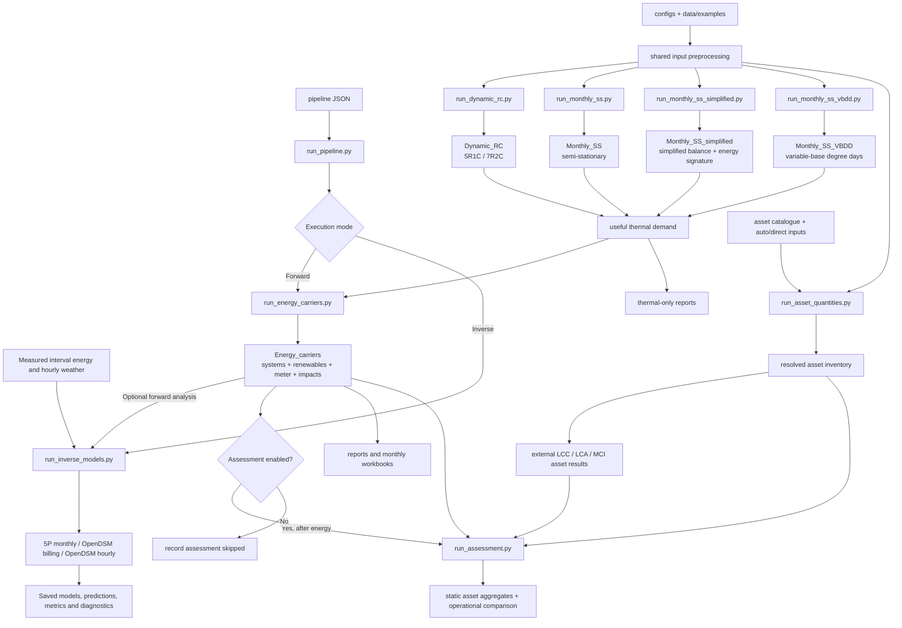

# Software structure and runner flow

The new optional [preflight](input_preflight.md), [measured acceptance](measured_data_validation.md)
and [release/CI flow](release_and_ci.md) surround these existing runners without
changing the thermal algorithms. The latter guide includes editable Mermaid
source for the reliability tooling.

The five named components have matching package folders under
`src/dt_prototype/`. Four runners select thermal solvers. Each can return useful
heating and cooling demand directly, or pass that demand to `Energy_carriers`
for system conversion, renewable allocation, grid exchange and impacts.

The Mermaid source below is the diagram text, so it can be edited and rendered
by Markdown viewers that support Mermaid.



The runner files are thin command-line entry points. The matching package
folders own their calculation and reporting code; `common/` owns shared input
contracts and preprocessing. Shared comparison adapters used by
`Monthly_SS_simplified` preserve the separate thermal solvers and do not alter
their equations.

`Inverse_models` is a supporting analysis package. It reuses the existing 5P
fitter and calls pinned OpenDSM through an isolated worker. Its interval/meter
contract supports measured data independently of simulation; no statistical fit
changes physical inputs. The [inverse-model guide](inverse_models.md) contains
the full dispatch diagram and the input/output contract.

The shared surface contract has an optional `boundary_condition` override.
`auto` preserves existing surface-type behaviour; `adiabatic` marks an
uncoupled thermal boundary while retaining physical construction and inventory.
Dynamic and monthly zone assembly apply it before thermal parameters/gains are
prepared. Simplified and VBDD adapters inherit those prepared coefficients.
Physical roof irradiance for renewables remains independent. See
[adiabatic surface boundaries](adiabatic_boundaries.md) for the input and limits.

## Component layout

Forward and inverse workflows share orchestration conventions, identities,
provenance and output status. They have different input contracts: geometry and
physical assumptions for simulation; interval energy/weather for statistical
fitting. Neither automatically calibrates the other. See the
[operational guide](running_forward_and_inverse.md) for execution examples.

| Component | Package | Runner | Responsibility |
|---|---|---|---|
| `Dynamic_RC` | `src/dt_prototype/dynamic_rc/` | `runners/run_dynamic_rc.py` | Dynamic_RC 5R1C and 7R2C models |
| `Monthly_SS` | `src/dt_prototype/monthly_ss/` | `runners/run_monthly_ss.py` | Monthly semi-stationary heat balance |
| `Monthly_SS_simplified` | `src/dt_prototype/monthly_ss_simplified/` | `runners/run_monthly_ss_simplified.py` | Simplified semi-stationary monthly balance, energy-signature inverse modelling and comparison adapters; includes the preserved historical Model 3 implementation |
| `Monthly_SS_VBDD` | `src/dt_prototype/monthly_ss_vbdd/` | `runners/run_monthly_ss_vbdd.py` | Monthly variable-base degree-day model and solar variants |
| `Energy_carriers` | `src/dt_prototype/energy_carriers/` | `runners/run_energy_carriers.py` | Shared systems, conversion curves, renewables, meter balances and carrier impacts |

`Assessment` is a supporting downstream package and runner. It validates and
aggregates externally assessed LCC, LCA and MCI asset results without changing
the five named simulation components. See [asset assessment integration](assessment_integration.md).

`src/dt_prototype/pipeline.py` and `runners/run_pipeline.py` orchestrate the
existing energy workflow and optional Assessment stage, disabled by default.
The wrapper can reuse a compatible completed energy run and records stage
execution and declared-row coverage separately. It does not call the standalone
calculators or change physical plant sizing. The [pipeline guide](pipeline.md)
defines configuration, provenance, outputs and the editable detailed diagram.

The supporting `run_asset_quantities.py` prepares auto/direct quantities from a
data catalogue and shared project drivers. Its inventory is reused across
thermal models, exported for external assessment and optionally checked by the
Assessment importer. It does not change solver/system settings. See
[quantity inputs, sizing rules and diagram](asset_quantities.md).

The embedded `Monthly_SS_simplified/model3/` directory preserves the original
Model 3 source and golden outputs as provenance. “Model 3” is the historical
method name; `Monthly_SS_simplified` is the current component name.

## Supporting folders

| Location | Purpose |
|---|---|
| `src/dt_prototype/common/` | Inputs, geometry, schedules, weather, validation and shared constants |
| `configs/`, `data/examples/` | Versioned runnable configurations and fixtures |
| `tests/` | Regression checks grouped by the five component names plus cross-component checks |
| `spreadsheets/` | Formula companions for the three monthly solver components |
| `reports/` | Accepted comparison results and workbook validation evidence |
| `scripts/` | Release audit, result reproduction and delivery audit |

## Runner commands

Run each entry point from the project root. Output directories must be new.

```powershell
python runners/run_dynamic_rc.py --config configs/example.json --output outputs/Dynamic_RC --model 5R1C
python runners/run_monthly_ss.py --config configs/example.json --output outputs/Monthly_SS
python runners/run_monthly_ss_simplified.py --config configs/example.json --output outputs/Monthly_SS_simplified --zone-mode both
python runners/run_monthly_ss_vbdd.py --config configs/example.json --output outputs/Monthly_SS_VBDD
python runners/run_energy_carriers.py --config configs/example.json --energy-config configs/energy_example.json --engine all --output outputs/Energy_carriers
```

`Energy_carriers` accepts `--engine Dynamic_RC`, `Monthly_SS`,
`Monthly_SS_simplified`, or `Monthly_SS_VBDD` to process one solver, and `all`
to produce comparable outputs for all four. Monthly and dynamic energy inputs
share the same downstream service and carrier calculations.
