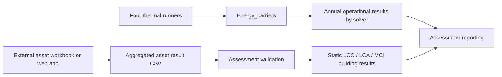

# Asset assessment integration

## Purpose and boundary

`Assessment` is a lean downstream component for LCC, LCA and circularity. An
external spreadsheet or web application calculates the result for each physical
asset. DT-Prototype validates those results, aggregates them by building and
keeps them next to annual operational results from `Energy_carriers`.

The thermal solvers and `Energy_carriers` do not price or characterize assets.
One static asset assessment therefore belongs to one building and assessment,
not to every solver case. This avoids multiplying embodied impacts or investment
costs by the number of thermal models. Operational energy, cost, primary energy
and carbon remain separate rows for each solver case.



The Mermaid block above is the original editable diagram source.

## Canonical assets

The external tool should use stable `asset_id` and `category_id` values. Display
names may be translated later, while IDs remain stable. Other envelope and
technical-system assets retain the names used by the main software.

| Asset name | Recommended `asset_id` | Recommended `category_id` | Quantity meaning |
|---|---|---|---|
| Heat pump system | `heat_pump_system` | `technical_system.heat_pump_group` | New catalogue: total rated heating thermal kW for the group. Three devices are represented by their summed capacity |
| DHW heat pump | `dhw_heat_pump` | `technical_system.heat_pump.dhw` | Separate hot-water device when selected; rated thermal kW. Historical benchmark counts are not converted implicitly |
| Water tank | `water_tank` | `technical_system.water_tank` | Litres of contained water. A distinct thermal buffer has its own `thermal_storage` asset |
| BACS (Building Automation and Control Systems) | `bacs` | `control.bacs` | kW assessment proxy only with an explicit basis, e.g. controlled thermal capacity |
| Fan coils HVAC | `fan_coils_hvac` | `technical_system.terminal.fan_coil` | Total rated terminal thermal kW at declared conditions |
| Battery system | `battery_system` | `energy_storage.battery` | Total usable electrical kWh |
| PV system | `pv_system` | `renewable.pv` | Total installed module DC kW at STC |
| Renovation area-based allowance | `renovation_area_allowance` | `allowance.renovation_area` | Renovated area in m² |

An `Energy_carriers` service technology ID is a simulation assignment, not
necessarily a physical asset. For example, several service IDs can point to the
same heat-pump system. The external assessment must emit that physical asset
once. The dedicated DHW heat pump is a second asset only when the configuration
actually selects a separate device.

## Explicit sizing

The optional [asset catalogue and quantity resolver](asset_quantities.md) now
prepares these fields using `auto` (estimate × factor) or `direct` (unchanged
entered quantity, effective factor 1). New inventories use m2 for surfaces,
kW for declared technology capacity, kWh for batteries and L for contained
water. The older unit-count examples below remain legacy benchmarks, not
capacity conversions. The resolver does not alter the thermal/system settings.

Every external result row carries these fields:

```text
assessed_quantity = base_quantity * sizing_factor
```

- `base_quantity` is the directly measured, scheduled, configured or explicitly estimated quantity.
- `sizing_factor` is an explicit positive setting. Use `1.0` when no allowance
  or oversizing is applied.
- `assessed_quantity` is the quantity used by the external calculation.
- `quantity_unit` states the physical unit.
- `sizing_basis` explains the origin of the base and factor.

DT-Prototype checks the equation with `abs(error) <= 1e-6 + 1e-9 ×
abs(expected)`. It does not multiply the reported LCC, LCA or MCI result again:
`value` is already the aggregate result for the assessed asset. This makes the
sizing choice auditable without double counting it.

The standalone LCC and LCA benchmark JSON files accept the same concept through
`base_size`, `sizing_factor`, `size` and `sizing_basis`. `size` must equal the
product. Legacy inputs containing only `size` remain valid and mean a factor of
`1.0`, so benchmark algorithms and results are unchanged.

## External result contract

The CSV header is:

```text
assessment_id,building_id,asset_id,category_id,asset_name,building_layer,scope_action,base_quantity,sizing_factor,assessed_quantity,quantity_unit,sizing_basis,module,metric_id,life_cycle_stage,value,unit,value_basis,study_period_years,currency,price_year,mass_kg,status,source
```

`module` is `LCC`, `LCA` or `MCI`. LCC and LCA values use
`value_basis=full_study_period` and a positive `study_period_years`. This means
replacement and end-of-life assumptions have already been applied externally.
LCC rows also declare currency and price year. LCA uses one `metric_id` per
indicator and `life_cycle_stage` such as `A1-A3`, `A4`, `B4` or `whole_life`.

All supplied numeric fields must be finite and cannot be booleans. A price year
is an integer from 1 to 9999. LCC values are total monetary amounts with `unit`
equal to `currency`. Study periods agree across LCC/LCA for one assessment and
building; LCC currency and price year agree across metrics. A different horizon
or price basis requires a separate assessment. Required identifiers cannot be
null, whitespace or a missing spreadsheet cell. Building IDs remain text, so
`001` is distinct from `1`.

MCI uses `metric_id=mci`, `unit=1`, `value_basis=current_asset` and an asset mass
in `mass_kg`. The building result is:

```text
building MCI = sum(asset mass * asset MCI) / sum(asset mass)
```

Each asset has at most one MCI row in an assessment. Complete MCI rows require
finite positive mass and a score in [0,1]. Other numeric columns cannot contain
infinity. Supplied mass is non-negative even on non-MCI rows.

`status` is `complete`, `missing` or `not_applicable`. Missing results must have
a blank `value`; they make the corresponding building aggregate missing. They
are never silently converted to zero. `scope_action` is `existing`, `retained`,
`installed`, `replaced` or `removed`.

An aggregate containing only `not_applicable` rows retains that status. Coverage
is explicitly limited to declared rows: the importer cannot discover a building
asset or indicator that the external tool omitted altogether. Supply explicit
`missing` or `not_applicable` rows for the assessment scope you intend to verify.
Keep physical items out of the current-building MCI inventory when they are
outside that scope, rather than silently treating a zero score as exclusion.

See `configs/asset_results_example.csv` for an illustrative file. Its values are
demonstration data, not an official assessment or factor database.

## Runner and outputs

The optional [pipeline runner](pipeline.md) now connects this existing workflow
to a fresh or reused Energy_carriers run. Assessment is disabled by default;
enabled settings may select LCC/LCA/MCI and a resolved inventory. Static
aggregation and annual operational reporting remain separate. The independent
command below retains its original strict whole-file validation and interface.

```powershell
python runners/run_assessment.py `
  --asset-results configs/asset_results_example.csv `
  --energy-results reports/shared_energy `
  --output outputs/Assessment_example
```

The output directory must not exist. The runner writes:

- `validated_asset_results.csv`: normalized asset rows and explicit sizing.
- `building_asset_results.csv`: solver-independent static aggregates.
- `building_operational_results.csv`: long-form annual operational metrics for
  each selected thermal solver when `--energy-results` is supplied.
- `manifest.json`: input hashes, row counts, status and calculation rules.

The energy join requires every building in the asset table to exist in
`energy_annual.csv`. Extra buildings in an energy run are allowed and omitted,
so a portfolio assessment may deliberately cover a subset. Currency is read
from the required adjacent `energy_config_resolved.json`. If an adjacent energy
manifest exists, it must have `status=complete`. Duplicate annual case identities,
blank identities, invalid calendar years and non-finite results are rejected.
The assessment manifest records source data/configuration/code hashes and an
error message when an export fails.

Optionally add `--asset-quantities path/to/resolved_asset_quantities.csv` to
verify the returned assets against a prepared inventory. This checks category,
scope action, unit, base quantity, factor and resolved quantity, without
rescaling external totals or changing the existing result CSV schema.

The illustrative CSV contains a deliberately chosen kW-based DHW example. It is
separate from the retained source benchmark, whose historical quantity of 26
uses `unit` and per-unit cost/impact factors. A source label alone does not prove
that 26 is the correct device count for a new building. Confirm the design and
factor basis externally; do not relabel the quantity as capacity to obtain a
plausible size.

New asset categories require data only. New LCA indicators require another
`metric_id` and unit. A future whole-life report can combine static and
operational results after it defines the study-period escalation, grid-factor
trajectory, replacement scenario and discounting rules. Those assumptions are
kept out of the current lean join so annual operational flows are not mistaken
for whole-life totals.
