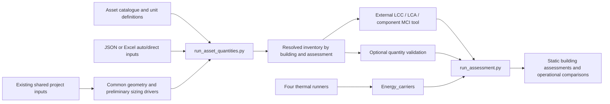

# Asset catalogue and auto/direct quantities

The optional quantity layer prepares one inventory per assessment and building
before an external tool calculates LCC, LCA and component MCI. It uses the same
building inputs as the main runners. It does not alter thermal solver equations,
carrier performance, physical geometry or installed capacity limits.

## Start with the Excel input

The [fillable input workbook](../data/examples/asset_quantity_inputs.xlsx)
contains the same illustrative building-1 inventory as
[`asset_quantities_example.json`](../configs/asset_quantities_example.json).
It supersedes the earlier requirements questionnaire for quantity entry. The
earlier questionnaire remains a record of catalogue/mapping questions.

On **Quantities**, edit the amber cells:

1. `B4`: assessment/scenario ID. `B5`: exact building ID from the project, stored
   as text. Preserve leading zeros. `B6`: default `auto` or `direct`.
2. Rows 11–22: review the selected assets. Blank `quantity_mode` in column C
   inherits the default. Set an individual row to the other mode when needed.
3. For **auto**, use column E's positive factor. Default 1 means no adjustment.
   Column F optionally overrides the catalogue's rule. Column G contains that
   rule's explicit JSON parameters. The example rates and factors are editable
   demonstration assumptions, not verified device selections or standards.
4. For **direct**, enter the final quantity in column D. It is used unchanged.
   The auto factor, rule and parameters are inactive. Zero is a valid known
   quantity; blank is missing and never triggers an auto fallback.
5. Review action H and source I. J can refine the quantity/rating basis and is
   mandatory for BACS because a controlled-capacity proxy needs a definition.
6. Scroll right: K is the unit, L the estimate, M the resolved quantity, N the
   input status and O a comparison with the original Python example. A legitimate
   edit can show `DIFFERENCE`; this is not a claim that the new value is wrong.

The workbook is a **prepared preview** of building 1. Factors, direct values
and the included HP/storage/PV/battery links recalculate in the workbook. A new
building, new category or edited rule/parameter can require a new estimate,
leaving the preview blank. Python always recomputes from the editable cells.
The Catalogue sheet is reference data; the CLI's JSON catalogue is authoritative.
Do not sort the fixed preview or edit its formulas/snapshots. Four extra input
slots are provided in rows 23–26; direct inputs can preview there. The reader
accepts additional literal input rows, but preview formulas are not automatically
extended. Use JSON for larger multi-building inventories.

Run from an installed project environment:

```powershell
python runners/run_asset_quantities.py --inputs data/examples/asset_quantity_inputs.xlsx --catalogue configs/asset_catalogue.json --config configs/example.json --output outputs/my_asset_quantities
```

The output directory must be new. Excel input requires the optional
`quantity-inputs` dependencies (`pip install -e '.[quantity-inputs]'`). JSON input
uses existing runtime dependencies. The reader consumes only the ten literal
input columns A:J and B4:B7. It rejects formulas in editable inputs and never
uses Excel's cached estimate, quantity or PASS cells as model inputs.

## Units and quantity meanings

| Asset group | Unit | Basis |
| --- | --- | --- |
| Facade, roof, basement insulation, glazing, renovation allowance | `m2` | Declared treated/selected physical area. Glazing is excluded from opaque facade area. |
| Heat pump group, dedicated DHW HP, other generators, fan coils | `kW` | Total rated **thermal** output at declared heating/cooling conditions, not device count or electric input. |
| PV | `kW` | Total installed module DC capacity at STC; kWp expressed as kW. |
| Batteries | `kWh` | Total usable electrical storage capacity. |
| Water tank / separate thermal water storage | `L` | Litres of water contained; 1 m3 = 1,000 L. Convert before entering a direct value. |
| Solar thermal collector | `m2` | Collector surface area; declare gross/aperture basis. |
| BACS | `kW` | Explicitly defined assessment proxy, for example controlled thermal capacity. It is not automatically inferred as BACS electrical demand. |

The heat-pump group quantity is the sum of its devices' rated capacities. For
three 14 kW devices, enter **42 kW**, not 3. This layer does not choose the
number, make or model of devices. A reversible HP is one physical asset; do not
assess a second cooling generator unless it actually exists. `water_tank` and
`thermal_storage` are separate rows only for separate assessed storage assets.

Old benchmark files and externally assessed rows using device counts remain
unchanged and supported by the legacy Assessment contract. Their factors must
not be relabelled as per-kW or per-litre factors. New capacity/volume inventories
need compatible external valuations. Whole-asset results remain totals.

## Selection rules

For auto:

\[
q_{resolved}=q_{estimate}\,f_{auto},\qquad f_{auto}>0.
\]

For direct:

\[
q_{resolved}=q_{entered},\quad q_{base}=q_{entered},\quad f_{effective}=1.
\]

Both modes produce the existing `base_quantity`, `sizing_factor`,
`assessed_quantity`, `quantity_unit` and `sizing_basis` fields. No rounding to
whole devices or catalogue sizes is implicit. Missing values are reported as
missing, never zero. Invalid numeric values, units, unknown keys and cyclic
dependencies are rejected. Inactive automatic fields do not change a direct value.

The default mode can be set at input-file, building or individual-asset level,
with the most specific selection taking precedence. Each building/scenario has
one resolved inventory shared by all four thermal model families. It is not
repeated once per solver. A JSON file may contain multiple actual buildings and
assessments; joins use `assessment_id, building_id, asset_id`.

## Automatic estimates and settings

The initial rule set is deliberately explicit:

| Rule | Estimate before the asset factor |
| --- | --- |
| `opaque_wall_area`, `roof_area`, `ground_area`, `glazed_area`, `floor_area` | Physical surface/floor areas from the shared geometry/envelope. |
| `heating_design`, `cooling_design` | Common preliminary static sensible design-capacity estimate in kW. |
| `dhw_recovery` | Maximum daily DHW thermal energy / supplied `recovery_hours` (0 < hours <= 24). |
| `dhw_daily_volume` | Maximum daily water draw in litres. The factor can represent a declared storage fraction; verify the temperature/draw-off basis. |
| `pv_roof_capacity` | Physical roof area × `coverage` × `module_kW_m2`. Coverage is in [0,1]. |
| `roof_fraction` | Physical roof area × `coverage`, for a declared collector-area basis. |
| `asset_multiple` | Referenced asset's **resolved** quantity × explicit `rate`. `rate_unit` must equal output/input units, e.g. `kWh/kW` or `L/kW`. |
| `asset_sum` | Sum of explicitly named resolved assets with the same unit. Useful for a declared shared heating/DHW capacity basis. Do not also assess calculation-only components as extra physical plant. |
| `fixed_estimate` | An explicitly supplied external `estimate`, followed by the auto factor. This permits a separately validated design method without modifying the thermal engines. |

Battery and buffer examples use explicit ratios to resolved PV and HP capacity.
Consequently, a direct PV input correctly drives an auto battery estimate. There
is no universal battery duration, storage-volume ratio or equipment count.
BACS has no default automatic estimate. It requires an explicit proxy basis and
a direct value or an expressly supplied rule/estimate.

### Preliminary capacity method (`static_v1`)

The common context uses Monthly_SS's prepared UA and hourly gains/airflow. It
does not use monthly energy as a peak load or run a selected forward solver.
Design outdoor temperatures are the supplied weather year's minimum/maximum.
Heating/cooling setpoints use each zone's highest active heating / lowest active
cooling setpoint, with the existing >17 C and <27 C activity convention.

For each zone and schedule timestep, the heating expression is:

\[
P_h=\max_t\{\max[UA(T_h-T_{cold})+H_i(t)(T_h-T_{cold})
+H_v(t)(T_h-T_{sup,h}(t)),0]+\max[Q_{AHU,h}(t),0]\}.
\]

Cooling uses the analogous positive sensible cooling requirement at `T_hot`,
plus a conservative maximum of non-negative internal and solar gains. Supply
temperatures and net AHU coil loads use the existing recovery/recirculation
function. Zone maxima are summed and W is converted to kW. Heating does not
credit internal/solar gains. DHW is separate. Latent cooling, diversity, device
derating, catalogue selection and operating capacity constraints are not added.
No hidden 1.2 factor or minimum device capacity is imposed. The explicit asset
factor owns the allowance. The method is a preliminary sizing approximation,
not a normative design-load calculation. A validated external estimate or direct
rating can replace it through the same contract.

Adiabatic flags affect UA and thermal gains, but do not delete physical surface
areas from the inventory. Subset/system ownership still requires explicit scope.

## Catalogue and input contracts

[`configs/asset_catalogue.json`](../configs/asset_catalogue.json) defines each
`catalogue_id`, category ID, name, layer, physical/virtual kind, unit, quantity
basis and optional default rule. A new category using an existing rule needs
data only. A new calculation rule needs a corresponding implementation/test.

Native JSON inputs have `schema_version=1.0`, `default_mode` and a `buildings`
list. Each entry has assessment ID, building ID, optional default mode and asset
rows. Each row declares `asset_id`, `catalogue_id`, action and source, plus the
selected mode's inputs. `quantity_unit`, if supplied, must match the catalogue;
there is no implicit conversion. Unknown fields and duplicate JSON/asset keys
are rejected. Asset IDs may be reused in different buildings/assessments.

Try the pure direct example without geometry/weather preprocessing:

```powershell
python runners/run_asset_quantities.py --inputs configs/asset_quantities_direct_example.json --catalogue configs/asset_catalogue.json --output outputs/my_direct_inventory
```

The runner writes `resolved_asset_quantities.csv`, normalized inputs, resolved
catalogue and a source/input-hashed manifest. An incomplete inventory is exported
with blank unresolved quantities and manifest status `incomplete`; the CLI exits
with code 2. An existing output directory is never overwritten.

## External assessment and optional validation join

Pass the resolved inventory to your external spreadsheet/web app. That tool
calculates aggregate LCC/LCA values, component MCI and mass. Return the existing
long-form result CSV, preserving the inventory's identities, unit and quantity
fields. Then run:

```powershell
python runners/run_assessment.py --asset-results path/to/external_results.csv --asset-quantities outputs/my_asset_quantities/resolved_asset_quantities.csv --energy-results path/to/energy_run --output outputs/my_assessment
```

The new `--asset-quantities` argument is optional. When supplied, it verifies
each returned asset's complete resolved quantity, category, scope action, unit,
base and factor. Values are not rescaled. Existing commands and the original
strict external-result CSV schema are unchanged. As before, coverage concerns
declared external rows; missing assessment metrics/assets are not invented.

## Architecture and verification

The optional [pipeline runner](pipeline.md) can check this resolved inventory
when enabled external asset results return. It accepts either auto or direct
preparation and does not rerun sizing or apply quantities to simulation plant.
Quantity preparation remains independently available when assessment is disabled.

The following Mermaid block is the editable diagram source:



New tests cover modes, defaults, direct zero/missing handling, units, ratios,
references/cycles, overflow, BACS basis, static sizing, workbook input parsing
and the optional assessment join. The workbook preview is recalculated with
Artifact Tool and checked against Python; native Excel was not automated.
See [implementation and regression evidence](../reports/asset_quantities_20261021/implementation_report.md).
