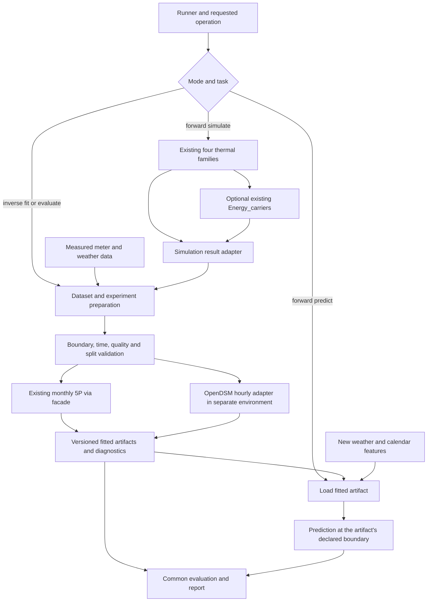

# Forward simulation and inverse energy models: integration options

Implementation follow-up: the requested 5P monthly, OpenDSM billing and OpenDSM
hourly adapters are now implemented. See the [current user guide](inverse_models.md)
and [validation report](../reports/inverse_models_20261021/implementation_report.md).
The analysis below records the earlier decision stage and is retained as history.

21 October 2026. **Analysis only.** No production code, configuration, tests,
workbooks or supplied OpenDSM files were changed. No dependencies were installed
and no new model fitting was executed for this analysis.

## Recommendation

Introduce an optional, shared **data-model workflow**, independent of the four
thermal solvers. Initially expose two existing backends: the bounded monthly 5P
fitter already in DT-Prototype, and the supplied OpenDSM hourly wrapper. Give
both the same dataset, training/validation, prediction and reporting principles.
Keep OpenDSM in its own Python environment and exchange versioned files with
the main application. Preserve the existing thermal and regression algorithms.

The workflow should accept simulated or measured observations without requiring
building geometry for measured-only analysis. It should save a fitted model for
later prediction, rather than refit every time predictions are requested.
Simulation followed by fitting should be a convenience sequence of existing
operations. Fitting measured energy does **not** automatically calibrate the
physical parameters of a thermal model.

This is compatible with the lean optional-stage approach recently adopted for
Assessment. It requires a new supported execution path, however: the current
pipeline always loads project and energy configurations and does not yet accept
inverse-analysis settings.

## 1. What is present now

### DT-Prototype: forward models and two 5P implementations

The forward families remain `Dynamic_RC` (5R1C/7R2C), `Monthly_SS`,
`Monthly_SS_simplified` and `Monthly_SS_VBDD`. `Energy_carriers` converts useful
thermal demand to technical-system/carrier and meter results.

The directory name `Monthly_SS_simplified` currently also contains a reusable
regression facility. Its placement does not limit it to that forward solver:

- [`five_parameter.py`](../src/dt_prototype/monthly_ss_simplified/five_parameter.py)
  fits independent simulated/measured series, uses bounded coefficients, and
  respects calibration/validation/excluded flags. Its group identity includes
  source, source run, building, scenario, weather, carrier and meter boundary.
- [`energy_signature.py`](../src/dt_prototype/monthly_ss_simplified/energy_signature.py)
  accepts a canonical CSV without running physics and exports immutable
  parameters, predictions, metrics and SVG figures. The existing command is
  `python -m dt_prototype.monthly_ss_simplified build-5p-report --input-csv ...`.
- Its older reference-run adapter recognizes two specific physics CSV layouts;
  it does **not** automatically read every current thermal/Energy_carriers export.
  It fits total useful heating plus cooling and explicitly labels that as
  non-metered useful demand.
- The retained historical
  [`model3/model3.py`](../src/dt_prototype/monthly_ss_simplified/model3/model3.py)
  has another `fit_change_point`/`calibrate` path using ordinary least squares
  and forward rows to supply temperature/days. It is not identical to the newer
  bounded fitter. Preserve it and its reference outputs; use the independent
  bounded fitter as the initial common 5P backend.

Thus measured-data fitting is partly implemented already. The missing work is
mainly common orchestration, adapters for current outputs/meters, reusable model
artifacts, broader validation and consistent reporting. Existing monthly input
requirements are documented in the
[5P guide](five_parameter_energy_signature.md).

### Supplied OpenDSM software

The folder contains a local **benchmark application around OpenDSM**, rather
than the upstream library's source. Its
[package definition](<../to_be_integrated/opendsm/pyproject.toml>) pins
`opendsm==1.2.7`, requires `pandas>=2.2,<3`, and uses `multimethod<2`.
DT-Prototype's verified environment uses pandas 3.0.3. Combining their current
requirements in one environment would therefore conflict. The wrapper also
uses Python's `tomllib`, so its declared minimum is Python 3.11; Python 3.12 is
the supplied tested setup. These are properties of the supplied files, not a
recommendation to upgrade or downgrade either project.

The wrapper already provides:

| Facility | Supplied implementation |
| --- | --- |
| Input | Hourly CSV mode, or files from another application named `energy_insight` |
| Models | Hourly temperature-only `nonsolar` and temperature-plus-GHI `solar` |
| Preparation | Clock alignment, standard-time model index, °C to °F conversion, usable-day selection and limited interpolation |
| Training/evaluation | In-sample fit plus blocked cross-validation |
| Artifacts | OpenDSM model JSON, hourly observations/predictions, folds and metrics |
| Diagnostics | Full-fit warnings/disqualifications, prediction uncertainty columns, cluster-specific temperature-response tables |

The upstream public API separates fit, prediction and JSON persistence, which
supports the proposed adapter approach. See the
[official hourly API](https://opendsm.energy/stable/documentation/eemeter/hourly_model/api/)
and [1.2.7 package record](https://pypi.org/project/opendsm/1.2.7/).
Online stable documentation may describe a later API; the supplied pinned
version must remain the initial compatibility target.

The supplied [configuration](<../to_be_integrated/opendsm/config.toml>) defaults
to `source="energy_insight"`. Its three required external input paths are absent
in this DT-Prototype workspace. Consequently, the default command is not a
ready-to-run DT-Prototype workflow. CSV mode is a useful starting point, with
the time-convention limitations below. No `test_*.py` files accompany this wrapper.

## 2. Define operations before defining a mode switch

Two user-facing modes are reasonable, with explicit operations beneath them:

| Mode | Operation | Inputs | Result |
| --- | --- | --- | --- |
| Forward | `simulate` | Geometry, envelope, schedules, weather, operating/system settings | Existing physical demand and optional carrier/meter outputs |
| Inverse | `fit` / `evaluate` | Observed targets, weather/features, quality and split definitions | Fitted statistical model, validation and diagnostics |
| Forward prediction | `predict` using a fitted model | Saved artifact and new weather/calendar features | Statistical energy prediction, without geometry or retraining |
| Combined convenience | `simulate`, then `fit` | Existing forward configuration plus selected result boundary | A surrogate of a specified solver/case |

The third row is the forward evaluation of an inverse-trained model, not another
thermal solver. It is useful for operation, weather normalization, comparison
and rapid predictions. A target that is unavailable in a new prediction period
must not be required as an input; observations are needed only if evaluating
prediction error.

For genuine physical calibration, a different problem must be solved:

\[
\theta^*=\arg\min_{\theta\in\mathcal B}
\sum_i w_i[y_i-F(x_i;\theta)]^2,
\]

where \(F\) is a thermal/system solver and \(\theta\) contains selected physical
parameters. That requires bounds, identifiability checks, repeated solver calls
and independent validation. Neither fitting a 5P curve nor fitting OpenDSM
performs that optimization. A fitted slope alone cannot uniquely identify UA,
air leakage, schedules and heat-pump performance. This can remain a later module.

## 3. Which data can support which model?

| Available observations | Existing monthly 5P | Supplied OpenDSM hourly |
| --- | --- | --- |
| Dynamic_RC hourly/subhourly simulation | Aggregate to complete monthly energy and matching temperature | Yes, after energy-conserving hourly aggregation and weather alignment |
| Monthly_SS / simplified / VBDD monthly results | Yes, through a result adapter | No genuine hourly targets; not directly compatible |
| Measured hourly/subhourly interval energy | Yes, after monthly aggregation and coverage checks | Yes, after time, units, boundary and quality checks |
| Measured daily energy | Potentially aggregate to monthly | Not without inventing an hourly profile |
| Monthly/irregular billing totals | Full compatible monthly periods for the existing fitter; irregular/long bills need a distinct adapter/extension | Not through the supplied hourly wrapper |

Do not distribute monthly energy across hours and treat that synthetic profile
as measured or independently simulated training data. It would train OpenDSM on
the allocation assumption. Hourly weather alone does not recover hourly load.

Daily and billing backends are additional future options in upstream OpenDSM,
but the supplied application implements neither. They would need their own
version-tested adapters. The official
[daily API](https://opendsm.energy/stable/documentation/eemeter/daily_model/api/)
and [billing API](https://opendsm.energy/stable/documentation/eemeter/billing_model/api/)
describe those separate model/data classes. Billing models must not be assumed
to need only monthly mean temperatures; preserve interval boundaries and obtain
the weather resolution their adapter requires.

### Preserve the 5P calculation basis

The current monthly model fits average daily energy:

\[
q_m=E_m/d_m=\beta_0+\beta_h(T_h-\bar T_m)_+
                  +\beta_c(\bar T_m-T_c)_+.
\]

Its average-power signature is the same equation divided by 24:

\[
\bar P_m=E_m/(24d_m)=b_0+b_h(T_h-\bar T_m)_+
                              +b_c(\bar T_m-T_c)_+,
\qquad b=\beta/24.
\]

Coefficients are nonnegative and \(T_h\le T_c\). The existing objective gives
equal weight to observations of daily energy, not to total monthly-energy
residuals. Keep that objective and its units unchanged initially. Six observations
are a software minimum, not evidence of an identifiable heating/cooling model.
The existing regime and bound warnings remain important with measured data.

Hourly models do not become the same model when their predictions are summed:
generally \(\operatorname{mean}[(T_h-T_t)_+]\ne
(T_h-\operatorname{mean}[T_t])_+\). Temporal features, irradiance and training
objectives differ too. A temperature-only OpenDSM variant is a useful comparator,
but does not have exactly the same feature information as monthly 5P.

## 4. Meter and physical boundaries must control comparisons

Choose the target explicitly before fitting. The current Energy_carriers exports
provide useful starting points:

| Target | Meaning and treatment |
| --- | --- |
| Useful sensible heating/cooling | Upstream thermal demand; not directly comparable with an electricity meter |
| `gross_electricity_kWh` | Building electrical load before PV self-consumption offset |
| `grid_import_kWh` | Nonnegative imported electricity, after PV matching |
| `grid_export_kWh` | Separate exported electricity |
| Import minus export | Signed net exchange; a different target, not supported by the supplied nonnegative input paths |
| Delivered gas/heat/other carrier | Its own carrier and physical meter boundary; raw gas volumes need explicit conversion factors |

The existing engine satisfies load = import + PV self-consumption, and
PV generation = self-consumption + export. A fit to grid import therefore
combines building load, technical-system behavior and renewable effects.
The OpenDSM `solar` variant can model an irradiance association; it is not a
physical identification of PV capacity or proof of solar causality.

Both the bounded 5P path and the supplied OpenDSM CSV reader currently exclude
or reject negative energy. Initially fit nonnegative import, consumption or
export separately. Do not clip signed net exchange to zero without declaring a
changed target. Preserve genuine zero imports: the supplied wrapper uses
`is_electricity_data=false` to avoid the pinned library's zero-to-missing behavior.
That workaround must be explicit and tested; keep the actual carrier identity
as electricity in the common metadata.

An inferred zone curve requires zone observations or a declared simulated zone
series. A whole-building meter does not independently identify two zone loads.
Similarly, a collapsed-zone case and a sum-of-zones case must remain separate
series, not be combined as repeated observations of one design.

Predictions of delivered energy or grid import must **not pass through
Energy_carriers conversion and PV matching again**. That would double-apply
systems/renewables. Predictions at an appropriate useful-demand boundary could
feed the carrier layer later, but must supply its required separate service
channels. A single fitted total heating-plus-cooling curve is not that complete
service input contract. Assessment/LCC/LCA joins should initially remain on the
existing completed simulation path; an inverse-only run need not perform them.

## 5. Shared input and artifact contract: lean proposal

Use a small common dataset envelope, not one rigid table containing every
backend's internal fields. Retain native-resolution observations and derive
the model-specific views reproducibly.

| Part | Minimum information |
| --- | --- |
| Series metadata | Dataset/series ID; simulated/measured source and run; building; optional zone; solver/case/representation for simulations; scenario; carrier; meter boundary and direction; units; site/weather reference |
| Observations | Series ID, interval start/end, interval energy, quality/exclusion flags and provenance |
| Weather | Actual matching timestamps/coverage; temperature in °C; GHI in W/m² where needed; source and any gap-fill/bias-correction provenance |
| Time metadata | UTC/civil/standard-time convention, site zone or fixed offset, start/end labels, durations and billing calendar |
| Experiment | Training/validation/test periods, folds, selected features, backend/version, settings and qualification policy |

Missing values remain missing; a measured zero remains zero. Cumulative registers,
power samples, interval kWh and irradiance-energy totals require different
conversions. Resampling sums energy, time-weights mean power/temperature, and
tracks usable duration. Features and targets must cover the same intervals.

The 5P facade can map this envelope into its existing canonical monthly columns.
Its current grouping does not contain `zone_id` or `representation`: merely
adding those columns would not separate fits. The adapter must map each distinct
case/zone to existing source/boundary keys and retain a lookup, or explicitly
version the grouping contract. A facade and lookup preserve the numerical fitter.

OpenDSM should receive one dataset per building/meter/case, with a sidecar
carrying those identities. Its `period` number is a segment identifier, not a
building identifier: the current CSV loader rejects overlapping dates across
periods. Do not represent several buildings observed on the same dates as its
periods 1, 2 and 3. Run isolated series jobs with distinct output directories.

Save a backend-neutral manifest plus the native fitted artifact:

- model/backend ID and exact environment versions;
- target, units, time convention, feature definitions and training period;
- source/configuration hashes, exclusion and fold definitions;
- 5P coefficients with daily-energy/average-power units and change points;
- native OpenDSM JSON plus wrapper metadata needed for prediction, including
  supported month/weekday combinations;
- training support, warnings, disqualifications, intended use and extrapolation
  policy; prediction coverage and failure reasons.

This avoids mixing model identity with the weather of a later prediction period.
The supplied wrapper's `Fit` object contains training-combination information
outside the raw model JSON; a reusable application artifact must preserve it
or reconstruct it explicitly. A simple 5P artifact loader/predict operation is
also needed; existing CSV reports already contain its essential parameters.

## 6. Time handling is the first required adapter change

DT-Prototype simulation/EPW timestamps are local standard time. In contrast,
the supplied OpenDSM reader accepts naive **civil-clock** hourly timestamps,
then localizes them with the site's daylight-saving rules. Feeding simulation
timestamps through that path would shift summer hours and drop/fill transition
hours that never needed those corrections.

Add an explicit input-clock choice at the adapter boundary: UTC/aware time,
civil time with a documented ambiguity policy, or fixed standard time. For
simulated data, preserve the standard-time convention and bypass civil-clock
reinterpretation. For measured data, retain original readings and resolve the
real meter convention, including the repeated autumn hour. The current reader's
unique naive timestamps cannot represent both occurrences of that hour.

Do not use a DST workaround as a general missing-data policy. Record interpolated
hours separately, reconcile energy before/after conversion, and retain true
zero/missing distinctions. The wrapper derives the standard offset using a
default reference year of 2021; a generalized adapter should use the dataset's
actual convention and dates, particularly across historical timezone changes.

For fixed-standard-time complete months, \(24d_m\) is the monthly duration.
For civil-calendar bills, elapsed hours may differ. The first 5P adapter should
explicitly preserve the existing calendar-day normalization and report that
basis; a duration-aware alternative must be versioned, not silently substituted.
The current validator limits `days` to 31, so irregular bills and equivalent
durations longer than that are not automatically supported. Keep calendar/billing
energy totals and their actual coverage available for comparison.

## 7. Supplied OpenDSM evidence and work needed before acceptance

The supplied summary files are retained results from the wrapper's Procida
benchmark, not new DT-Prototype validation. Reading those files gives:

| Period | Solar hourly CV(RMSE) % | Nonsolar hourly CV(RMSE) % | CV hours / in-sample hours | Relative prediction coverage % |
| --- | ---: | ---: | ---: | ---: |
| 1 | 42.2575 | 46.4265 | 7,848 / 8,088 | 97.03 |
| 2 | 42.0125 | 44.4743 | 4,944 / 5,088 | 97.17 |
| 3 | 46.7960 | 49.3966 | 8,376 / 8,472 | 98.87 |

Coverage here means CV-scored hours divided by in-sample-scored hours, not total
calendar coverage. All six final fits have nonempty disqualification lists;
`ignore_disqualification=true` is configured. These results demonstrate stored
outputs and benchmark behavior, not qualification for operational savings use.
See the supplied [metrics — full archive](validation_archive.md)
and [fit diagnostics — full archive](validation_archive.md).

Important adapter-level acceptance work, based on source inspection:

| Finding | Required integration treatment |
| --- | --- |
| `predict()` behavior and missing month/weekday support | Retain the wrapper's version-specific JSON-reload and consecutive-day workarounds; export unsupported days and reasons, not just fewer scored observations |
| CV diagnostics are incomplete in exports | `cross_validate` returns fold records, but `run_period` discards them; per-fold fit warnings/disqualifications also need retention |
| Qualification overrides | Distinguish exploratory benchmark fits from accepted prediction models; the wrapper hardcodes prediction override to true, so policy cannot be inferred from fit settings alone |
| Short/gappy baselines | Report data sufficiency independently of successful execution; the saved 1.2.7 artifact specifies a 329–366-day baseline rule. CV folds can breach sufficiency even when the full fit qualifies |
| Saved precision | Prediction/metric CSVs use six significant digits. Use full-precision machine outputs in future parity tests and separate display rounding; preserve supplied evidence |
| Output ownership | Current writer uses `exist_ok=True` and overwrites result files. A DT-compatible job must own a new immutable output folder and record stage outcomes/provenance |
| Input quality | Add integration checks for finite energy, clock/interval semantics, typed flags, usable-day counts and fold feasibility; CSV mode currently checks negative energy but has no explicit finite-energy check |
| Prediction-only execution | Current benchmark command fits and cross-validates together. Add an adapter path for loading an artifact and predicting without measured targets or refitting |
| Console entry point | The supplied `pipeline.main` returns a result dictionary; its installed console-script exit behavior needs a test. Use the supplied script path initially rather than assume equivalent exit semantics |

These are proposed wrapper/adapter improvements. They are not changes made in
this analysis and do not require modifying the upstream library's algorithms.

## 8. Fair validation and reporting for all backends

Choose separate evaluation questions:

1. **Within-period generalization:** blocked folds can compare models on held-out
   observations inside a stable operating regime. The supplied seven-day,
   round-robin scheme uses training data both before and after test blocks;
   it is not a future forecasting test.
2. **Operational prediction:** hold out a later period chronologically, keeping
   the fitted model frozen. Where data permit, use a complete seasonal baseline
   and an independent subsequent period. Do not put observations from both sides
   of a retrofit into one unchanged baseline model.
3. **Simulation surrogate:** train on a declared solver/case and evaluate on
   held-out weather or operating scenarios. Different thermal models of the
   same dates are different generating processes, not independent samples to
   shuffle into one train/test pool.

Use common evaluation intervals for comparisons, export the mask and report
both common-support scores and each model's coverage. Feature preparation or
learned weather correction must not use held-out targets. Preserve OpenDSM
qualification diagnostics for every fold, including exploratory overrides.

At native resolution, report RMSE/MAE, bias, R² where defined, energy totals,
coverage and residual plots. Compare hourly OpenDSM and monthly 5P at monthly
energy/average-power resolution only after explicit aggregation; do not rank an
hourly RMSE against a monthly RMSE. Do not broadcast monthly predictions into
an invented hourly accuracy test. Preserve missing-hour/month coverage rather
than let a partial sum look like complete monthly energy.

Current metric conventions differ:

- The independent 5P reporter uses observed minus predicted; training RMSE and
  normalized bias use `n-p`, and untouched validation uses `p=0`.
- The supplied OpenDSM benchmark also uses observed minus predicted, but its
  `scores` function uses `n` for both in-sample and CV calculations.
- Historical embedded Model 3's `nmbe` uses simulated minus reference, with
  a different sign from the independent reporter.

Introduce a common comparison table with observed-minus-predicted residuals
and `p=0` for held-out scoring, while retaining native/legacy metrics and their
definitions. Do not silently rewrite accepted historical tables or equate an
OpenDSM coefficient count with effective degrees of freedom. Zero/near-zero
mean load makes percentage metrics unstable or undefined; keep absolute errors
and totals rather than report misleading percentages.

Useful inspectable figures are time-series overlays, out-of-sample residuals,
monthly/annual energy bias, 5P power-temperature signatures and OpenDSM
cluster-conditioned responses. The supplied response curves hold irradiance
profiles and calendar clusters fixed while varying temperature; they are not a
single universal 5P curve or direct physical heat-loss coefficients. The
[official hourly model report](https://opendsm.energy/assets/reference_docs/hourly_model_report.pdf)
describes its temporal/temperature/solar feature structure.

Keep native uncertainty separate from common point-error metrics. The 5P path
currently provides no predictive intervals. Future bootstrap/other intervals
would need explicit methods; aggregated hourly uncertainty must account for
error dependence rather than assume independent hours.

## 9. Architecture options

| Option | Changes and tradeoff | Suitability |
| --- | --- | --- |
| A. Manual file bridge | Keep both commands separate; export simulation/meter CSVs and compare reports manually | Smallest experiment, but time/boundary/quality handling and provenance remain fragmented |
| B. Shared orchestration and adapters; external OpenDSM process | One dataset/experiment/report contract; existing 5P facade in the main environment; pinned OpenDSM worker in its own environment | **Recommended:** lean shared behavior while preserving tested numerical code and dependencies |
| C. Direct in-process OpenDSM dependency | Reconcile pandas and the broader dependency stack; rerun all forward/inverse regression evidence | Possible later, but unnecessary disruption for this first integration |
| D. Separate service/container | Same contracts over a process/service boundary; worker queues and environment images | Appropriate for future larger deployments; additional operational work now |

For option B, a proposed supporting package such as `Inverse_models` would own
the dispatcher, dataset preparation, facade/worker adapters and reports. It would
not be a fifth thermal solver. Leave the current bounded 5P implementation in
place behind the facade, and retain the embedded legacy implementation untouched.
No general plugin framework is needed for two backends.

The following Mermaid is the original editable source for the proposed flow:

A minimal future interface could offer `simulate`, `fit`, `predict`, `evaluate`,
with a two-mode UI grouping simulation/prediction as forward and training as
inverse. Existing pipeline files would default to forward unchanged. Inverse
dispatch must happen before requiring `ProjectInputs` or `EnergyConfig`;
measured-only training must work without geometry, an energy scenario or a
physical simulation run. Any combined simulation-plus-fit request should also
be able to reuse completed outputs.

The present pipeline parser is strict and does not implement these new fields.
The operation names and package name above are proposals, not working commands.
An initial dedicated inverse runner could share existing functions, with one
small dispatch addition to the pipeline later. OpenDSM's Python executable
should be an explicit setting: disabled jobs should neither import it nor
require its environment, and execution should not install packages automatically.

## 10. Suggested implementation sequence after this analysis

1. Agree the common series/target and time conventions. Start with nonnegative
   electricity import or gross consumption, plus explicitly labelled useful
   thermal signatures where desired. Preserve per-building/case identities.
2. Add a common inverse runner and 5P facade, including current-output adapters
   for all four thermal families and a measured monthly CSV route. Preserve
   current fitting results and add saved-artifact prediction.
3. Connect the pinned OpenDSM worker for genuine hourly dynamic/measured data.
   Implement explicit standard/civil/UTC adapters, job-level immutable outputs,
   fit/predict separation and full fold/qualification/coverage reporting.
4. Validate target/units, energy-conserving resampling, DST boundaries, genuine
   zeros versus gaps, unsupported prediction periods, series separation and
   serialization/reload parity. Include held-out synthetic truth and suitably
   scoped measured data. Run the existing forward suite and accepted-result
   comparisons to demonstrate preservation.
5. Expose optional simulation-then-fit orchestration and side-by-side reports.
   Treat physical parameter calibration, pooled multi-building learning and
   additional OpenDSM daily/billing models as separately specified extensions.

For scale, fit one model per building/meter/case initially. Use a job table and
bounded worker concurrency; do not concatenate unrelated buildings into one
training series. A district model should use a synchronized district-meter
boundary. Statistical pooling across similar buildings is another modeling
choice requiring normalization and building-aware validation, not a free
consequence of batching the current wrapper.

The main later user inputs are the intended meter boundary, an example measured
dataset with its clock/units, the operating/retrofit period definitions and the
desired holdout purpose. No additional decision is necessary to conclude that
option B is feasible. No implementation has been performed here.
