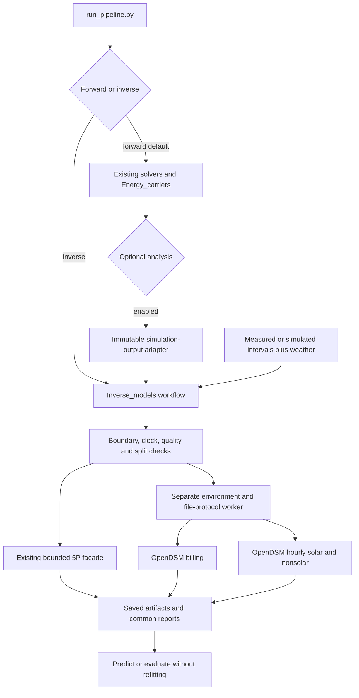

# Shared inverse energy models

For a single operational walkthrough, see [running forward and inverse](running_forward_and_inverse.md).
The [22 October review](reliability_review_20261022.md) supplements the original
implementation evidence with input validation and orchestration fixes.

`Inverse_models` fits simulated/measured energy independently of geometry and
the four thermal solvers. Backend IDs are `5p_monthly`, `opendsm_billing`, and
`opendsm_hourly` (solar/nonsolar variants). The existing bounded 5P fitter is
unchanged. Statistical fitting does not calibrate physical UA, capacitance,
infiltration or efficiency, and does not resize plant or repeat PV accounting.

## Setup and examples

Run the main application in its normal installed environment. OpenDSM 1.2.7
requires pandas 2 and therefore uses an isolated environment; the main tested
environment retains pandas 3. From the project root with Python 3.12:

```powershell
python -m venv .venv-opendsm
.\.venv-opendsm\Scripts\python.exe -m pip install -r requirements-opendsm-verified.txt
python runners/run_inverse_models.py --config configs/inverse_5p_example.json --output outputs/my_5p
python runners/run_inverse_models.py --config configs/inverse_billing_example.json --output outputs/my_billing
python runners/run_inverse_models.py --config configs/inverse_synthetic_example.json --output outputs/im_accept
python runners/run_inverse_models.py --config configs/inverse_prediction_example.json --output outputs/my_prediction
```

`requirements-opendsm-verified.txt` freezes tested versions; the shorter
`requirements-opendsm.txt` records top-level constraints. Set `opendsm_python`
explicitly. A 5P-only job needs neither OpenDSM nor that setting. Runtime does
not install packages. Reinstall the editable package for the new console command
`dt-inverse-models`. For source-only execution, set `PYTHONPATH=src` first.

Paths resolve relative to the configuration. Outputs must be new directories;
use short names on Windows. The prediction example references `outputs/im_accept`;
adjust `model_dir` if training elsewhere. The examples are explicitly synthetic,
with 2022 training and warmer 2023 holdout weather, not real measured-building
accuracy evidence. Completed evidence directories already exist in this workspace;
choose new names for another run.

## Operations and pipeline dispatch

`operation=fit` estimates from eligible train rows only, saves artifacts, and
predicts all declared intervals. `predict` loads artifacts without refitting;
targets may be absent/blank with `split=predict`. `evaluate` loads artifacts and
scores supplied observations. Measured-only runs need no project configuration,
geometry or energy scenario.

The pipeline defaults to forward mode. An inverse-only configuration is:

```json
{"schema_version":"1.0", "mode":"inverse", "inverse_config":"inverse_5p_example.json"}
```

Use `runners/run_pipeline.py --config configs/pipeline_inverse_example.json
--output outputs/my_inverse_pipeline`. Dispatch occurs before geometry loading.
Forward configurations can add:

```json
"analysis": {"enabled":true, "config":"inverse_simulation_example.json"}
```

The completed/reused energy directory is passed to the inverse adapter, without
another thermal run. See
[`pipeline_forward_inverse_example.json`](../configs/pipeline_forward_inverse_example.json).
Analysis defaults to disabled and then needs no inverse inputs/environment.
Assessment is separately optional. Completed energy survives later analysis failure.

## Configuration

Root fields: `schema_version="1.0"`, `operation`, `source`, optional `clock`,
`models`, `model_dir`, `opendsm_python`, `worker_timeout_s`, `description`.
Unknown fields, duplicate JSON keys and non-finite JSON constants are rejected.
Example model selection:

```json
"models": [
  "5p_monthly",
  {"backend":"opendsm_billing", "options":{"allow_disqualified":true}},
  {"backend":"opendsm_hourly", "options":{"variant":"nonsolar", "seed":42}},
  {"backend":"opendsm_hourly", "options":{"variant":"solar", "seed":42}}
]
```

`allow_disqualified` defaults to false per OpenDSM model. True is an explicit
exploratory override, not M&V qualification. Native warnings/disqualifications
remain visible. `5p_monthly.options.fit` accepts the existing FiveParameterConfig
fields, preserving its grid, coefficient constraints and objective.

For prediction/evaluation, `model_dir` contains `model_index.json`. Omit `models`
to load each series' available artifacts, or select a subset. An explicitly
requested missing series/model pair fails visibly. `evaluate` requires eligible
observed energy; use `predict` for input without targets. Series
IDs and building/zone, carrier, boundary, scenario, representation and configured
clock must match training. Raw timestamps can use explicit offsets and are
converted into that clock. Artifact hashes detect corruption, not authorship.

## CSV data contract

Use `source.type="csv"`, `observations`, `weather`, and a `series` metadata map.

| Table | Fields |
| --- | --- |
| Observations | `series_id,interval_start,interval_end,energy_kWh,split,quality` |
| Weather | `weather_id,time,temperature_C,ghi_Wm2` |

Unknown CSV columns and source settings for the wrong source type are rejected.
An optional exported `duration_h` is checked against timestamps; it cannot
override the interval duration. Validate flags before resampling or applying
date cutoffs, so misspelled flags cannot become missing or training data silently.

Intervals are half-open `[start,end)`, and energy is **interval kWh**. Difference
cumulative registers or integrate power before import. Genuine subhourly energy
is summed into complete hours; incomplete hours remain missing, never scaled or
interpolated. Subhourly intervals cannot overlap, cross an hour or mix splits
within an hour. Other observation/billing intervals use hourly boundaries.

`split` is `train`, `validation`, `test`, `excluded`, or `predict` (default train).
`quality` is `valid`, `missing`, or `excluded` (default valid). Blank energy stays
missing and genuine zero stays zero. Negative/infinite targets are rejected;
use separate nonnegative import/export series instead of signed net exchange.
Missing/ineligible observations do not enter fitting/scoring.

Weather must be unique, contiguous hourly interval-start data covering each
observation/bill. Temperature is complete/finite. GHI is optional for nonsolar
models; solar requires complete nonnegative values. Weather IDs distinguish
sites; omitting the weather column uses `default`. No hourly load is fabricated
from billing totals.

Each `source.series` key is a stable series ID with required text metadata:
`source_type` (`measured`/`simulated`), `source_id`, `building_id`, `scenario_id`,
`carrier`, `meter_boundary_id`, `weather_id`. Optional fields: `zone_id`, `model`,
`representation`, `description`. Preserve leading zeros. Different buildings,
zones, solvers and representations need distinct series. Batching does not pool
unrelated buildings or identify zone loads from a building meter.

Optional source `train_end`/`validation_end` assign chronological splits and may
not cut bills. Without `validation_end`, the tail is validation; otherwise the
later tail is test.

`validation_end` without `train_end` is invalid. Cutoffs replace train/validation/test
labels, while explicit `excluded` and `predict` rows remain protected. A holdout
label without eligible observed energy does not count as validation evidence.

## Time and billing safeguards

CSV input requires `clock.convention` (`standard`, `civil`, `utc`) and an IANA
`clock.timezone`, e.g. `Etc/GMT-1`, `Europe/Rome`, `UTC`. Standard/UTC clocks need
the appropriate fixed offset. Explicit-offset civil timestamps preserve both
autumn repeated hours. Ambiguous/nonexistent naive civil times are rejected.

Hourly fitting uses complete 24-hour days in fixed standard time. Unsupported
month/weekday combinations and incomplete edge days retain missing predictions
with reasons. The initial hourly worker supports whole-hour standard offsets.

Billing boundaries are local midnight. Eligible training bills must form one
contiguous block; hold out entire later bills. Interleaved holdouts are rejected
because pinned-library preprocessing can bridge missing reads. At least six
actual training bills are required, without implying adequate seasonal coverage
or satisfying all native sufficiency rules.

The adapter uses the public BillingBaselineData dataframe constructor with
exact hourly weather coverage. For this pattern, the 1.2.7 `from_series` shortcut
can trim the final bill. Processed training energy must equal supplied bill
energy within `1e-6 + 1e-9*abs(reference)`. Prediction uses weather only and sums
native daily predictions over the actual bills. Irregular/off-cycle bill handling
is additionally checked by the library.

5P requires complete calendar months with one split per month. It preserves
`E/calendar_days` fitting and `E/(24*calendar_days)` signature coefficients.
Common mean-power reporting uses actual elapsed hours; the bases differ on DST
civil months and are labelled. Irregular/longer bills are not forced into 5P.

## Simulation adapters

`source.type="energy_run"` uses `results`, `project_config`, optional `resolution`
(`monthly` default or `hourly`), `target`, `buildings`, `models`. It verifies a
completed energy run and matching project/input hashes, then reads results and
hourly EPW weather without rerunning physical calculations.

Selectors are nonempty lists of unique exact text identifiers. Requested but
absent buildings/models fail explicitly. A string is not interpreted as a list.

Monthly data come from `energy_monthly.csv` for all four thermal families.
Hourly data come only from genuine dynamic interval exports, with energy-conserving
subhourly aggregation. `thermal_monthly` reads thermal-only `monthly.csv` instead;
choose a useful-demand target such as `heating_kWh`. Cases/representations remain
separate. EPW retains its existing non-leap-year and standard-time conventions;
CSV data can include leap years.

Thermal-only VBDD exports now include completion/engine metadata and preserve
individual zone IDs alongside collapsed alternatives during inverse import.
For older VBDD exports lacking completion metadata, regenerate them; do not
manually mark an unverified old run complete. A project-based export is needed
for the simulation adapter; standalone monthly-input JSON alone does not provide
the required hourly weather provenance.

Default target is `grid_import_kWh`; standard alternatives include gross
electricity, export, PV generation and separate useful thermal services. Another
kWh target needs explicit carrier/boundary metadata. Useful demand is not
directly comparable with an electricity meter, and predicted meter energy must
not pass through Energy_carriers/PV matching again.

```powershell
python runners/run_inverse_models.py --config configs/inverse_simulation_example.json --output outputs/my_monthly_fits
python runners/run_inverse_models.py --config configs/inverse_dynamic_example.json --output outputs/my_dynamic_fits
```

The monthly example reads the retained `reports/shared_energy` reference and
covers 51 cases with 5P/billing; it does not require a generated `outputs/pl_off`.
Set `source.results` to a fresh run for current simulation fitting. The dynamic example covers
five genuine 5R1C cases with all backends. Those single-year simulation examples
have no holdout and are flagged; the synthetic example tests held-out prediction.

## Outputs

| Output | Meaning |
| --- | --- |
| `manifest.json` | Input/config/code/environment provenance, qualifications, warnings, failures and coverage |
| `inputs/` | Normalized observation/weather snapshots and series metadata |
| `model_index.json`, `models/.../artifact.json` | Hashed fitted artifacts with target identities/native payloads |
| `predictions.csv` | Native interval predictions, residuals, durations and reasons |
| `monthly_predictions.csv` | Complete calendar-month aggregates only |
| `metrics.csv` | Native/monthly scores by series/model/split, counts and coverage |
| `comparison_metrics.csv` | Monthly common-support scores across successful backends on the same series |
| `figures/` | Monthly energy/residual and mean-power/temperature signature plots |
| `worker/` | Requests, full-precision predictions, versions and diagnostic log |
| `report.md` | Actual status, per-model qualifications/errors and links to CSVs/figures |

Common metrics use observed minus predicted and `p=0`; they do not overwrite
legacy/native metrics. Compare identical boundaries/intervals/coverage only.
Forecasts without targets have no accuracy score. Percentage metrics are
undefined near zero mean energy. Native negative predictions remain visible
with warnings. Hourly native uncertainty is retained; monthly uncertainty is
blank rather than assuming independent hourly errors.

Overall status/CLI code: `complete`/0, `incomplete`/2 (missing predictions),
`partial`/2 (some models failed), `failed`/1. Structural errors also return 1.

The native OpenDSM 1.2.7 zero-coefficient metric validation failure is handled
by a [scoped compatibility layer](opendsm_compatibility.md). All five supplied
buildings now fit both hourly variants. The worker accepts the true zero count
without altering coefficients or predictions, records its use and retains
qualification warnings. Native uncertainty remains missing in the supplied
comparison. Inspect `models.csv` and the manifest before using results. These
single-year cases check fitting, not out-of-sample accuracy; the separate
two-year synthetic run checks holdouts and reload. Actual meter datasets can use
the new [measured-data validation procedure](measured_data_validation.md).
Worker failure does not discard successful 5P results. Processing success,
qualification and held-out coverage are distinct; no holdout is flagged. A
successful exploratory fit is not physical calibration or an approved savings model.

## Architecture

Original editable Mermaid source:



The supplied benchmark remains unchanged. The worker uses the installed pinned
library's public APIs. General references: [billing API](https://opendsm.energy/stable/documentation/eemeter/billing_model/api/)
and [hourly API](https://opendsm.energy/stable/documentation/eemeter/hourly_model/api/).
Locally tested 1.2.7 behavior controls this implementation. See the
[validation report](../reports/inverse_models_20261021/implementation_report.md)
and preceding [analysis](forward_inverse_models_analysis_20261021.md).
