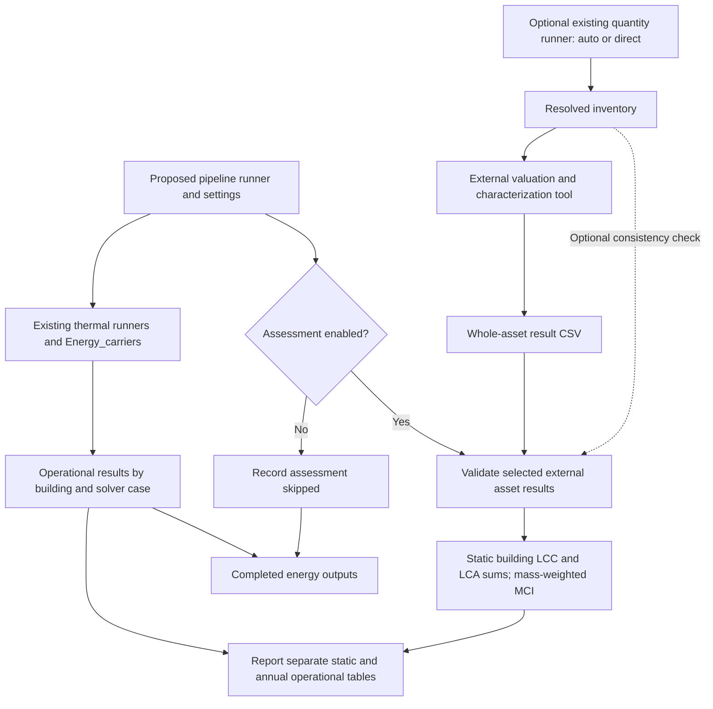

# Optional LCC / LCA / MCI connection: analysis before implementation

Implementation follow-up: the approved orchestration is now documented in the
[pipeline guide](pipeline.md). The text below preserves the preceding analysis
and its pre-development backup boundary; statements about unimplemented settings
describe that earlier state.

Date: 21 October 2026. This document describes a proposed development; it does
not introduce executable settings or change any calculation. The current code
and spreadsheets were backed up before this document was written.

## Conclusion

**Yes. The existing structure supports an optional downstream assessment stage
with small orchestration changes and no changes to the four thermal solvers.**
The lean first implementation should validate and aggregate externally computed
whole-asset LCC/LCA/MCI results, using the existing `Assessment` functions. A
setting should enable or skip that stage; its default should be disabled.

This follows the agreed approach: quantities are prepared in DT-Prototype,
valuation and characterization happen in an external spreadsheet/web tool, and
whole-asset results return for building aggregation. It is different from
automatically executing the three standalone calculation engines. Those engines
exist and are preserved, but their input contracts require additional adapters
and assumptions before they can be called automatically from simulation inputs.

## Backup and verification

The backup is outside the project, within the workspace:

- [Archive — development-only](validation_archive.md#local-development-material)
- [Per-file source manifest — development-only](validation_archive.md#local-development-material)
- [Verification results — development-only](validation_archive.md#local-development-material)
- [Restore instructions and scope — development-only](validation_archive.md#local-development-material)
- [Archive and metadata checksums — development-only](validation_archive.md#local-development-material)

The ZIP contains **724 source/support files**, 80,670,333 uncompressed bytes;
its size is 39,736,562 bytes. Its SHA-256 is
`e89b4bd43a9dd3e7a15097d59988c7f205e013dce14f3cbfcec07e37ad6ba216`.

The snapshot includes all standalone LCC, LCA and Circularity files and four
verification workbooks; current Assessment/quantity code; compatible shared
project source, runners, configurations, example data and tests; documentation
and reports; quantity input workbooks and outputs; and assessment/annual-energy
reference data. Shared source is retained to make future restoration compatible,
even though only assessment is the subject of this backup. The manifest lists
every included file. Installed dependencies, caches, junctions and duplicate
generated energy runs are excluded. Original workspace folders outside
DT-Prototype, including the original `energy_model` source workbook, are outside
this snapshot; extracted benchmark inputs and the refactored workbooks are included.

ZIP CRC checks and every archived source SHA-256 passed. A second inventory and
hash check confirmed that the selected original files were unchanged. This work
did not rerun the simulation suite. The retained earlier evidence records 390
tests plus three subtests, and reproduction of 318 accepted result tables with
maximum numeric difference 0.0. See the earlier
[implementation report](../reports/asset_quantities_20261021/implementation_report.md)
and [reproduction comparison — full archive](validation_archive.md#reports-asset-quantities-20261021-reproduction-comparison-json).
Those are prior regression results, not newly executed integration tests.

## What the current implementation already provides

| Part | Current capability | Boundary for this proposal |
| --- | --- | --- |
| Four thermal families | `Dynamic_RC` (5R1C/7R2C), `Monthly_SS`, `Monthly_SS_simplified`, `Monthly_SS_VBDD` produce demand | Keep their equations, inputs and outputs unchanged |
| `Energy_carriers` | Shared technical-system conversion, renewables, meters, annual operational costs/primary energy/carbon | Keep the calculation unchanged; consume its annual exports |
| Asset quantities | JSON/Excel inputs; common inventory; auto estimate × factor or direct quantity | Reuse when preparing an assessment; do not resize simulated equipment implicitly |
| `Assessment` | Strict external result CSV; optional inventory consistency checks; building aggregation; optional annual energy join | Reuse as the downstream import/aggregation stage |
| Standalone LCC | Investment, replacements, residual/demolition, maintenance and source-specific electricity operating-cost calculations | Remains a separate calculator needing prices, rates, lifetimes and energy/baseline inputs |
| Standalone LCA | Multi-indicator, per-item and building embodied impacts, replacements, and legacy baseline comparisons | Remains a separate calculator needing compatible impact factors and lifecycle assumptions |
| Standalone Circularity | Material-to-component MCI and mass-weighted component-to-building MCI | Remains a separate calculator; the importer accepts precomputed asset MCI plus mass |

The relevant existing entry points are
[`run_energy_carriers.py`](../runners/run_energy_carriers.py),
[`run_asset_quantities.py`](../runners/run_asset_quantities.py) and
[`run_assessment.py`](../runners/run_assessment.py). Currently these are separate
commands. Neither the energy workflow nor the Assessment CLI has a combined
enable/disable setting or an individual-module selector.

The reusable APIs are `Energy_carriers.workflow.run_project(...)`,
`Assessment.quantities.run_quantities(...)` and
`Assessment.workflow.run_assessment(asset_results, output, energy_results=None,
asset_quantities=None)`. The last function imports external totals; it does not
call `calculate_lcc`, `calculate_lca` or either Circularity calculator.

See [assessment integration](assessment_integration.md),
[quantity inputs](asset_quantities.md), the
[Assessment workflow](../src/dt_prototype/assessment/workflow.py), and the
[external-result contract](../src/dt_prototype/assessment/contract.py).

## Recommended connection and setting

Add a thin pipeline runner and a separate pipeline configuration that references
the existing project and energy configurations. This keeps new assessment
settings outside thermal `operating`, `dynamic` and other solver sections. The
old runners should continue working exactly as before. Avoid a new plugin
framework, factor database or dependency on the standalone folders in this step.

The following is an **illustrative proposed configuration fragment, not a
currently accepted input file**:

```json
{
  "assessment": {
    "enabled": false,
    "modules": ["LCC", "LCA", "MCI"],
    "asset_results": "assessment_inputs/asset_results.csv",
    "resolved_quantities": null
  }
}
```

`enabled` controls the stage. `modules` would optionally select one or more
assessments; selecting all three is the natural default when enabled. Empty or
unknown selections should be rejected when enabled. Paths should resolve
relative to the pipeline configuration, with the resolved paths and hashes
recorded in the run manifest. `resolved_quantities` is an optional consistency
check, independent of whether quantities were auto or direct.

For the smallest first delivery, the single switch can enable all declared
modules in an input CSV; selected-module filtering can follow. If filtering is
included immediately, it needs a deliberate reader/validation adaptation:
`load_asset_results` currently validates the entire file before returning it.
Simply filtering its returned dataframe would still let an invalid disabled
module block the selected calculation. Preserve structural CSV checks, validate
selected rows, and record skipped modules. Do not change the legacy runner's
strict whole-file behavior.

The proposed orchestration is:



The fenced block is the original editable Mermaid source. It represents data
dependencies; the pipeline should validate enabled external inputs early,
before a long simulation where possible.

### Disabled

Run the existing requested thermal/energy chain. Do not require or load external
assessment files, the catalogue, quantity workbook, standalone factors or
assessment-only dependencies. Do not emit zero LCC/LCA/MCI values: record that
the stage was skipped. Quantity preparation may still be requested separately
to prepare a later external assessment; it must not become mandatory just
because the pipeline exists.

### Enabled with returned external results

Validate selected input results and, if supplied, their resolved inventory.
Reuse the existing energy output or execute the existing energy workflow, then
call the existing Assessment aggregation/join in a separate new output directory.
Run the static aggregation once per assessment/building, not once per solver.
Keep annual operational results for each solver/representation/year.

Support referencing a completed energy run for assessment-only reruns; changing
a price, embodied factor or MCI should not force another thermal simulation.
This reuse must check provenance and building/scenario association, rather than
selecting a directory solely because its filename looks suitable. The current
join checks building IDs, annual identities, currency and an adjacent manifest
when present, but does not prove that a returned assessment describes the same
design as the energy run. A pipeline manifest should explicitly bind the project,
energy run, assessment ID and input hashes. A simple initial rule is one named
assessment scenario per pipeline run, with multiple buildings allowed.

### Enabled before external results are available

Do not invent prices, impacts, mass or component MCI from geometry or capacity.
The quantity runner can export an inventory for external completion. Treat this
as preparation, not a completed assessment. Resume the assessment from those
returned results later. No web-tool invocation or external transmission is
needed in the first implementation.

## Contracts and aggregation rules to preserve

Use the existing identities and contracts rather than introduce another asset
schema. Inventory joins use `(assessment_id, building_id, asset_id)`. Preserve
building IDs as text, including leading zeros. Keep category, physical ownership,
scope action, units and sizing provenance consistent across modules.

For quantities:

\[
q_{auto}=q_{estimate}f,\quad f>0;
\qquad q_{direct}=q_{entered},\quad f_{effective}=1.
\]

Surfaces use m², rated technologies kW with their thermal/electric rating basis,
PV installed DC kW, batteries usable kWh, and water tanks/storage litres. A
three-device heat-pump group uses its summed rated thermal capacity. BACS needs
an explicit capacity-proxy basis. A zero direct quantity is different from a
missing direct input. There is no fallback to auto for missing direct inputs.

The returned `value` is already a whole-asset result. Do not multiply it again
by quantity or factor. For each compatible metric/stage/basis group:

\[
R_{building}=\sum_i R_i
\quad\text{for LCC/LCA},\qquad
MCI_{building}=\frac{\sum_i m_i MCI_i}{\sum_i m_i}.
\]

MCI needs physical mass as well as its dimensionless score. m², kW, kWh and L
are not substitutes for mass; no density or mass-per-capacity conversion is
implicit. Positive mass is required for complete MCI records. Portfolio MCI
would also need mass weighting, not the arithmetic mean of building scores.

Keep missing and not-applicable statuses. The current importer checks **declared
rows only**; it cannot discover an omitted asset or indicator. The optional
quantity check also verifies returned rows against the inventory, rather than
requiring every inventory row to have every possible indicator. Therefore an
enabled module must not be labelled fully covered solely because parsing
succeeded. Record requested/present modules and explicit missing rows. A later
strict coverage option would need a declared list of applicable assets/metrics;
it should not assume every asset requires every indicator.

The workflow manifest's `status=complete` currently means successful processing;
individual aggregate rows may still have `status=missing`. The proposed pipeline
must distinguish execution status from assessment coverage. A valid incomplete
import should remain available for inspection, with an explicit incomplete
coverage summary. Invalid inputs/execution failures should return failure, never
silently turn the stage off. Preserve a successfully completed energy run even
if a later assessment fails; record the two stage outcomes separately.

Shared service assignments can refer to one physical device. Assess that device
once. A dedicated DHW heat pump or separate tank/buffer is another asset only
when it exists. For geometry subsets, adiabatic flags change heat transfer, not
physical ownership or assessment area. Ownership/shared-system allocation remains
an explicit input. Avoid overlapping component/assembly rows and renovation
allowances describing the same assessed work.

## Important limits of a simple connection

1. **Assessment quantities do not configure simulation plant.** The auto/direct
   layer intentionally leaves physical geometry, installed capacity limits,
   conversion efficiency and renewable settings unchanged. Initially keep this
   one-way connection. A future quantity-to-plant adapter needs an explicit
   mapping to the energy configuration, including thermal versus electrical
   capacity and shared devices; it is a separate development. Otherwise a costed
   PV/battery/HP quantity can differ from the simulated equipment. Check or declare
   that difference instead of presenting the two as a matched design.
2. **Use a common inventory for solver comparisons.** Giving each solver its own
   automatic size would change the design as well as the thermal method. The
   current common preliminary estimate is appropriate for a controlled comparison.
   Independently sized design scenarios can be added explicitly later.
3. **Annual operation and lifetime totals are different bases.** The current join
   keeps them in separate tables. It does not discount, escalate or repeat annual
   carrier results over a study period. Do not add annual operating cost/carbon
   to full-period asset totals or count externally included operation twice.
   Reporting a whole-life total would require explicit scope, study period,
   replacement/residual rules, price/grid trajectories and discounting decisions.
   Other LCA operational indicators cannot be inferred from carbon/primary-energy
   factors alone.
4. **Current examples are not one matched end-to-end dataset.** The historical
   external-result example and the new quantity example use different assessment
   identities and some legacy count/volume units. They should not be joined
   unchanged. A representative returned CSV must use the resolved inventory's
   IDs, units, factors and quantities. Historical benchmarks should remain intact.
5. **No new valuation evidence is created by a switch.** Current demonstration
   prices, impacts, storage ratios and sizes are not verified project data.
   Preserve their labels; an enabled result is as complete as the supplied data.

## If automatic execution of standalone calculators is wanted later

| Calculator | Additional mapping and data needed |
| --- | --- |
| LCC | Inventory to `technologies`; compatible unit prices, service life, replacement/maintenance fractions; project life/rates, renovation area and baseline bills; chosen per-solver annual electricity import/export and price basis |
| LCA | Inventory to technology quantities; indicator definitions and compatible factors per quantity; renovation scope, service lives/replacement treatment, stage labels and baseline/fuel assumptions where used |
| MCI | Precomputed component score plus physical mass, or complete material fractions, recovery efficiencies, service-life/utility inputs and masses for component calculation |

These are separate JSON calculation contracts, not direct consumers of the
external Assessment CSV. Do not use their legacy per-device benchmark factors
as per-kW factors or relabel m³ as litres. Unit conversion needs compatible
valuation data, not just a renamed field. Existing source-specific formula
limitations remain documented in the standalone READMEs, including the LCC
equal-rate condition and LCA fuel-fired DHW source formula branch.

In particular, the standalone LCC includes electricity operating costs; its
global result can depend on solver case. It cannot simply be attached as one
solver-independent static asset total and then combined again with operating
costs. An automatic backend would need to separate asset-only calculations from
per-case operation, or report the full result under a separate solver-dependent
contract. The selected LCC block is also electricity-specific for post-retrofit
operation; a general multi-carrier lifecycle backend would need explicit
methodological extensions. The recommended external-total connection avoids
changing those tested source algorithms.

## Minimum implementation and validation plan after approval

1. Add a pipeline orchestration runner/configuration parser, disabled by default;
   retain old runners and formats. Reuse existing APIs and separate output folders.
2. Add enabled-stage preflight, optional selected-module handling, explicit
   project/assessment/energy provenance, stage status and coverage summaries.
   Keep the legacy Assessment command's behavior unchanged.
3. Provide one consistent demonstration inventory/result pair and commands for
   disabled, enabled and assessment-only reuse runs. Update runner instructions,
   architecture, contracts and workbook instructions. Existing calculation
   workbooks need no formula change for an orchestration-only switch.
4. Validate the following cases before accepting the connection:

| Check | Required evidence |
| --- | --- |
| Disabled, including invalid unused assessment paths | Existing thermal/carrier result tables unchanged; stage skipped; no assessment data needed |
| Enabled with complete matched input | Same asset/operational tables as the current separate runners; input and output hashes recorded |
| Selected modules, if supported | Only requested results; missing selected modules reported; inactive module data does not control selected calculations |
| Missing values and undeclared scope | No fabricated zeros or completeness claim; missing/not-applicable semantics preserved |
| Quantity consistency | Both auto and direct inventories accepted when matched; IDs, category, scope, units and quantity mismatches rejected |
| Single/multiple buildings and solver cases | One static assessment per building/scenario; separate annual cases; no physical-asset duplication |
| Assessment-only rerun | Existing energy data untouched and provenance checked; no thermal rerun |
| Failure after completed energy | Energy remains complete; failed/incomplete assessment recorded distinctly; diagnostic and appropriate exit status |
| Regression suite and accepted energy reference | Existing tests pass, plus meaningful orchestration tests; accepted numerical outputs remain within established tolerance |

There is no need for a new pricing database or a restructuring of the thermal
engines to implement this first stage. For a useful project run, the user would
need a returned external asset-results file consistent with a chosen inventory,
and a clear indication of its assessment scope and energy-design association.
Whole-life combination and automatic standalone backends can remain later,
separately specified work.

**No integration code, configuration, spreadsheet formulas or calculation
algorithms were changed during this backup and analysis.**
