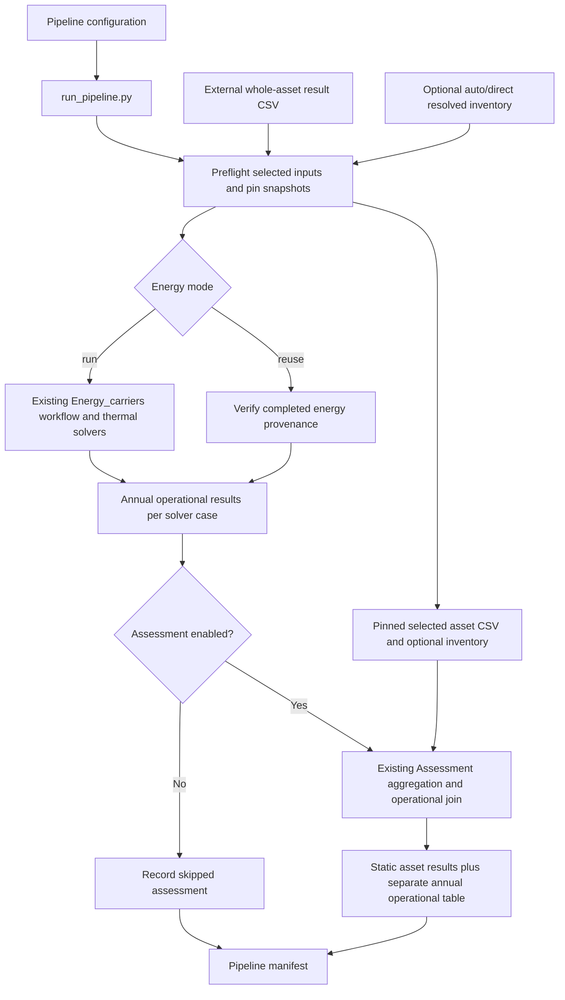

# Simulation pipeline with optional asset assessment

The pipeline now also supports `mode=inverse`, requiring `inverse_config` and
accepting only `schema_version`, `description`, `mode`, and `inverse_config`.
It bypasses geometry, thermal simulation, energy conversion and assessment.
Omitting `mode` retains the forward workflow described below. Forward mode can
set `analysis: {"enabled": true, "config": "inverse_simulation_example.json"}`
to fit the newly completed energy results; it defaults to disabled. The selected
inverse source must be `energy_run`; the current run replaces its configured
results directory. An analysis failure preserves successful energy outputs and
is recorded separately. See [inverse models](inverse_models.md) for examples,
status/exit rules and an editable diagram covering both execution modes.

`run_pipeline.py` runs the existing thermal/Energy_carriers workflow and optionally
imports external whole-asset LCC/LCA/MCI results. Assessment defaults to disabled.
It does not invoke the standalone calculators, assign prices/impacts, resize
plant or combine annual operation with lifetime totals. Existing runners remain
available with their existing interfaces.

## Run

From the project root, after the normal editable package installation:

```powershell
# All four thermal families through the unchanged energy layer; no assessment.
python runners/run_pipeline.py --config configs/pipeline_example.json --output outputs/pl_off

# Reuse that completed energy run and connect all three external assessments.
python runners/run_pipeline.py --config configs/pipeline_reuse_example.json --output outputs/pl_join

# Alternatively, new Monthly_SS simulation followed by external assessment.
python runners/run_pipeline.py --config configs/pipeline_assessment_example.json --output outputs/pl_on
```

Every output directory must be new. Short paths help avoid Windows limits in
deep solver case folders. `dt-pipeline` is the equivalent installed command
(reinstall the editable package to register the new console entry point).
For a source checkout without installation, set `PYTHONPATH=src` in the shell
before using runners; the existing runners have the same package requirement.

## Configuration contract

The new pipeline JSON has `schema_version="1.0"`, required `project_config` and
`energy_config`, optional `description`, optional `energy`, and optional
`assessment`. All paths resolve against this JSON file's directory. Unknown
fields, duplicate JSON keys and non-finite JSON constants are rejected. The
existing project/energy configuration files and their schemas are unchanged.

| Setting | Meaning |
| --- | --- |
| `mode` | `forward` (default) or the separate `inverse` configuration above |
| `analysis.enabled` | Forward-only optional inverse analysis, default `false` |
| `analysis.config` | Required inverse configuration when analysis is enabled |
| `energy.mode` | `run` (default) or `reuse` |
| Run: `engine` | `all` (default) or one of the four existing thermal component names |
| Run: `model` | Optional `5R1C`/`7R2C`, only with `engine=Dynamic_RC` |
| Run: `zone_mode` | `both` (default), `sum`, or `collapsed` |
| Run: `vb_solar` | `direct` (default) or `temperature_linear` |
| Run: `vb_options` | Optional existing VBDD `utilisation`, `eta_heating`, `eta_cooling`, `attenuation_heating`, `attenuation_cooling`; forwarded without algorithm changes |
| Reuse: `results` | Required directory containing a completed energy run; run selectors are rejected in reuse mode rather than implying filtering |
| `assessment.enabled` | Boolean, default `false`; inactive assessment values/files are not used |
| Enabled: `assessment_id` | Required single scenario identifier; all selected CSV rows must match |
| Enabled: `modules` | Unique nonempty list drawn from `LCC`, `LCA`, `MCI`; defaults to all three |
| Enabled: `asset_results` | Required external result CSV using the existing Assessment contract |
| Enabled: `resolved_quantities` | Optional resolved inventory CSV, from either auto or direct preparation, to check returned quantities |
| Enabled: `design_note` | Optional description of design association and limitations, retained in the manifest |

For example, to enable only LCA and MCI in a copied pipeline configuration:

```json
{
  "enabled": true,
  "assessment_id": "pipeline-demo",
  "modules": ["LCA", "MCI"],
  "asset_results": "pipeline_assets_example.csv",
  "resolved_quantities": "pipeline_quantities_example.csv"
}
```

This object belongs under `assessment`; it is not a complete pipeline file.
When disabled, no asset CSV, quantity file, catalogue or Excel dependency is
required. Omit the `assessment` object entirely for the same default behavior.
Its known inactive fields are ignored, while misspelled setting names remain errors.

Enabled preflight checks the CSV header and row widths, rejects unknown module
names, then validates selected modules only. Unfinished numeric values in known
unselected modules do not block selected calculations. The independent
`run_assessment.py` retains its strict validation of the entire supplied file.

## Data flow and ownership



The Mermaid block is the original editable diagram source. The external input
and quantity branches are inactive when assessment is disabled.

One inventory/assessment belongs to a building and scenario, irrespective of
solver count. Complete LCC/LCA values are summed within compatible
metric/stage/unit/study groups. MCI is weighted by physical mass in kg. Whole-asset
values are never multiplied by quantity again. Operating results stay in their
own table, by building/year/model/representation/resolution. A static asset
assessment is not duplicated for each solver.

Auto/direct quantities remain a separate preparation step; the pipeline can
check their exported CSV but does not run sizing or feed its results into plant
settings. Physical ownership, shared equipment, geometry subsets and assessment
scope must be declared. Declaring an assessment ID/design note binds the supplied
data for reporting; it does not prove that externally assessed equipment matches
the equipment used for energy simulation. Do not double count operation already
included in an external LCC/LCA total.

## Reuse and provenance

Both new and reused energy runs must have a completed manifest, project/input
hashes matching the selected project, a matching resolved energy configuration,
and current simulation source hashes. Assessment/orchestrator source changes
are allowed for reuse, while shared/thermal/carrier source changes require a
fresh energy run. Forward-model options for reuse are those recorded in the
source energy manifest. The pipeline does not pretend to rerun or select new
cases through reuse settings.

The manifest records the configuration path/hash, project/input and energy
configuration hashes, original asset CSV hash, selected-input snapshot hash,
optional inventory hash, selected/skipped modules, assessment/building IDs,
energy manifest/annual CSV hashes and design note. Legacy energy manifests do
not contain an annual-output digest: reuse checks compatibility and hashes the
annual file at connection time; it cannot independently authenticate historical
result bytes. Keep the accepted result comparison evidence for that purpose.

Preflighted selected CSV and inventory copies are retained under `inputs/`, so
editing an external file during simulation does not change the assessed inputs.
The existing Assessment manifest separately hashes the code it executes. A
reused energy directory is read only and is not copied or rewritten.

## Outputs, coverage and failure behavior

| Path | Purpose |
| --- | --- |
| `manifest.json` | Pipeline provenance, stage execution status, coverage summary and diagnostic on failure |
| `energy/` | Existing energy outputs for `mode=run`; absent for reuse, whose directory is recorded in the manifest |
| `inputs/selected_asset_results.csv` | Validated selected external rows, when assessment is enabled |
| `inputs/resolved_quantities.csv` | Optional pinned inventory |
| `assessment/validated_asset_results.csv` | Existing normalized asset output |
| `assessment/building_asset_results.csv` | Existing static aggregates |
| `assessment/building_operational_results.csv` | Existing separate annual operating metrics |
| `assessment/manifest.json` | Existing downstream Assessment provenance |
| `inverse/` | Optional inverse-stage report, models, predictions, scores and native diagnostics |

`stages` separates preflight, energy, assessment and inverse analysis. Disabled assessment is
`skipped`, never a fabricated zero result. A failed stage records its error;
stages not reached become `not_run`. A successfully completed/reused energy
stage is retained if the later assessment fails. This is not a silent fallback
to a successful combined pipeline.

Processing and coverage are distinct: an assessment can execute successfully
while exporting missing aggregates. The pipeline then has `status=incomplete`
and preserves the output for inspection. Coverage reports missing aggregate
rows, requested modules absent for each declared selected building, and
not-applicable groups. It is explicitly limited to declared selected rows: it
does not infer entirely omitted buildings, assets or indicators. Emit explicit
`missing`/`not_applicable` rows for the intended scope. An input with no selected
rows is invalid rather than a successful empty assessment.

The CLI returns **0** for completed processing with no declared coverage gaps,
**2** for incomplete coverage or partially successful inverse models, and **1** for invalid input or
execution failure. A status of complete is not a claim of whole-building coverage
or independent validation of external valuation factors.

## Matched demonstration inputs

[`pipeline_quantity_inputs_example.json`](../configs/pipeline_quantity_inputs_example.json)
can be resolved with the existing quantity runner. The checked-in
[`pipeline_quantities_example.csv`](../configs/pipeline_quantities_example.csv)
and [`pipeline_assets_example.csv`](../configs/pipeline_assets_example.csv)
use the same IDs and quantities for all five supplied buildings. They assess
one illustrative 42 kW HP group per building: 90,000 EUR investment, 20,000 kg
CO2e A1–A3 impacts, and MCI 0.61 with 900 kg mass. These are supplied example
totals, not outputs from a pricing or factor backend and not whole-building
valuations. The fixed 42 kW is not reconciled to simulated equipment. Production
data should replace these values and declare the real scope and design match.

The existing legacy asset examples remain unchanged. Historical count-based
benchmark values are not converted to capacity-based factors by this pipeline.
Existing monthly and standalone formula workbooks require no formula changes
for this orchestration addition; see [workbook instructions](workbook_instructions.md).

See [implementation and validation](../reports/pipeline_20261021/implementation_report.md)
and the preceding [integration analysis](optional_assessment_analysis_20261021.md).
