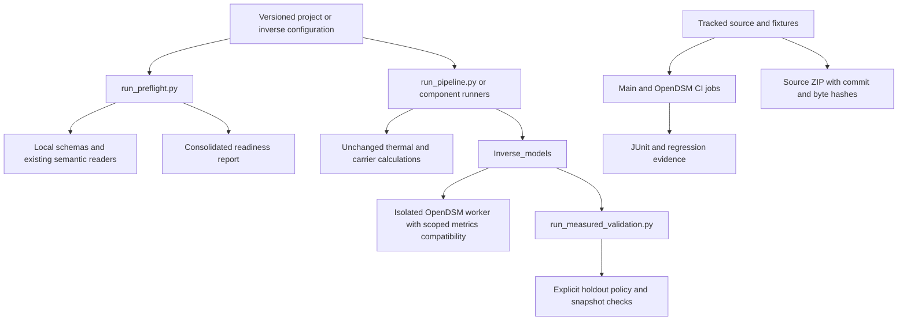

# Reproducible validation, version tracking and source releases

> Lean GitHub distribution: monthly reference fixtures and selected summaries are included. For the complete hourly/Excel evidence and strict 318-table reproduction, follow [validation archive instructions](validation_archive.md).

Version **0.5.1** adds reliability tools and a scoped OpenDSM compatibility fix.
The project now has a local Git repository. No remote repository or upload was
created. Changes, input libraries, test fixtures and accepted reports are tracked;
virtual environments, generated `outputs/`, `node_modules/` and `data/private/`
are excluded. `.gitattributes` preserves exact bytes across checkouts because
input and result manifests use SHA-256 hashes. Keep private data untracked.

## Supported and unverified environments

| Environment | Status |
| --- | --- |
| Windows 11 x64, CPython 3.12.10, recorded main/worker dependencies | Locally verified environment |
| Windows Server 2022 x64, CPython 3.12.10 | Configured CI target; remote CI execution requires a hosted repository |
| Linux/macOS, other Python versions or dependency combinations | Not qualified by this release; run the full evidence procedure before adoption |

`requires-python` in package metadata describes an installation range, not a
tested platform matrix. Do not mix the main pandas 3 environment with the
OpenDSM pandas 2 environment. Runtime versions and the installed dependency
closures are recorded in the [implementation evidence directory](../reports/reliability_improvements_20261023/).
The main lock captures 26 packages; the worker freeze remains unchanged.

## Portable source-checkout recipe

Extract the source ZIP to a short, writable directory or clone the repository.
Run from its root. Source execution avoids a dependency on editable-install
build tools. No environment activation is required:

```powershell
py -3.12 -m venv .venv
.\.venv\Scripts\python.exe -m pip install -r requirements-main-verified.lock.txt
.\.venv\Scripts\python.exe -m pip check
py -3.12 -m venv .venv-opendsm
.\.venv-opendsm\Scripts\python.exe -m pip install -r requirements-opendsm-verified.txt
.\.venv-opendsm\Scripts\python.exe -m pip check
$env:PYTHONPATH='src'
$env:DT_OPENDSM_PYTHON=(Resolve-Path .\.venv-opendsm\Scripts\python.exe).Path
.\.venv\Scripts\python.exe runners/run_preflight.py --config configs/pipeline_example.json
.\.venv\Scripts\python.exe -m pytest -q --junitxml=outputs/release_tests.xml
.\.venv\Scripts\python.exe scripts/check_test_evidence.py outputs/release_tests.xml
```

Check `$LASTEXITCODE` after each command; stop if it is nonzero. For inverse
runs, set `opendsm_python` in the configuration; `DT_OPENDSM_PYTHON` selects the
runtime for the **tests**. Fresh dependency download/install requires network
access. Locks record the verified versions, not an included offline wheelhouse.
The source ZIP contains no virtual environment and is not a standalone executable.

Run the forward/inverse commands in the [operational guide](running_forward_and_inverse.md).
The full release procedure also regenerates all forward cases, compares the
318 accepted tables, verifies assessments, and runs `audit_shared_energy_delivery.py`
and `verify_release.py` using the new run and its actual JUnit count. Preserve
historical manifests instead of editing their source hashes.

## CI jobs

[validation.yml](../.github/workflows/validation.yml) defines two independent
jobs on push, pull request and manual dispatch:

- **main:** installs the main lock, checks dependencies, executes all tests
  except those marked `opendsm`, and validates the example forward inputs.
- **opendsm:** installs both isolated environments and executes the real backend
  tests, including the former zero-coefficient failure and saved-model reload.

Both jobs retain JUnit artifacts and use `check_test_evidence.py` to reject
empty runs, failures, errors and skips. A missing optional worker therefore
cannot silently pass a full validation job. Running the complete suite locally
also requires zero skips for release acceptance. CI is configured but cannot
run remotely until this local repository is placed on an authorized host.
The workflow follows the [GitHub Python CI documentation](https://docs.github.com/en/actions/tutorials/build-and-test-code/python).

## Create an inspectable release archive

Review and commit the intended files first. The builder rejects modified tracked
files, tracked generated/private folders and symlinks, and does not overwrite an
existing archive:

```powershell
git status --short
# Review, stage and commit the intended release using your own Git identity.
python scripts/build_source_release.py --output outputs/releases/dt-prototype-0.5.1.zip
```

Only tracked files enter the ZIP. The archive includes a
`SOURCE_RELEASE_MANIFEST.json` with commit ID and per-file hashes; the sidecar
`.verification.json` records the archive hash and size. Every stored file is
read back and verified. This establishes byte integrity, not a substitute for
test evidence or an authenticated signature. Inspect untracked files before
packaging so that required new files are not accidentally omitted.

## Architecture (editable Mermaid source)



Preflight, execution, empirical acceptance and release packaging are separate
operations. Physical calibration, pooled models and new portfolio orchestration
remain outside this implementation, as agreed.
