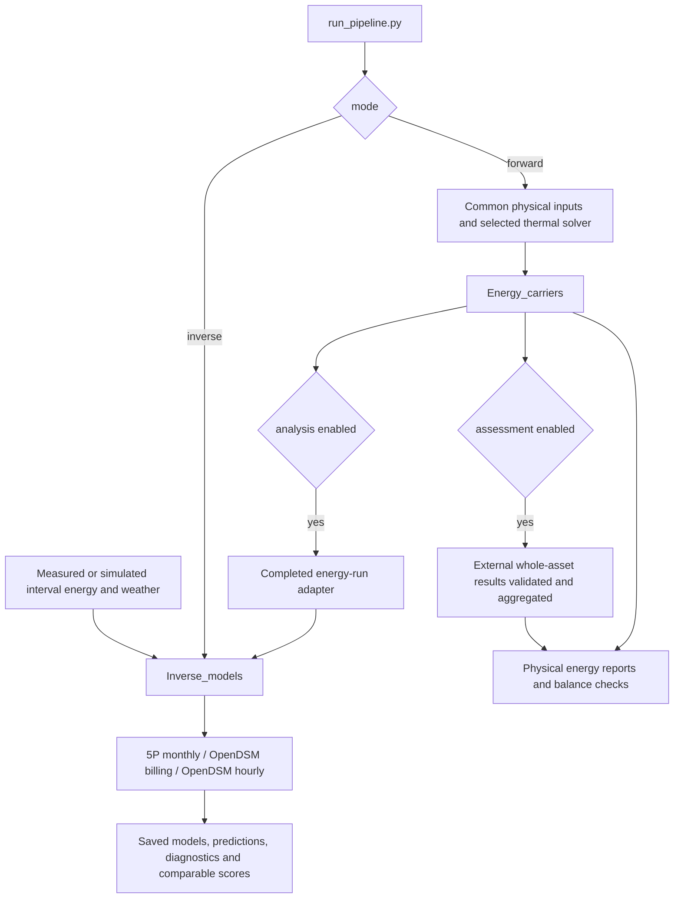

# Reliability review — 22 October 2026

Historical review of the 22 October source state. The agreed reliability actions
were subsequently implemented; see the [24 October completion report](reliability_improvements_20261023.md).
The results and remaining-limit statements below describe this original review.

The current prototype supports the intended forward/inverse structure without
requiring an architectural rewrite. This review corrected boundary defects and
documentation drift while preserving thermal equations, energy conversion,
renewable accounting, the bounded 5P fitting algorithm and native OpenDSM algorithms.
The main remaining execution limitation is the already documented native OpenDSM
hourly fitting failure on two supplied buildings.

Use [running forward and inverse](running_forward_and_inverse.md) for practical
commands, environment setup, model selection, measured-data input, saved-model
execution and result inspection. [Architecture](architecture.md),
[pipeline](pipeline.md), [physical contracts](data_contracts.md) and
[inverse contracts](inverse_models.md) provide the supporting detail.

## Scope and method

Reviewed runner dispatch and package entry points, shared configuration and
library readers, inverse interval/weather processing, split and quality rules,
saved-model selection, completion status, assessment integration, comments and
current Markdown guidance. Verification combines the full regression suite,
new defect reproductions, real-library fits, complete forward regeneration,
saved-model execution, optional-stage combinations, unchanged-input/workbook
hashes and release/documentation audits. This is targeted code and execution
review, not a mathematical proof over all possible inputs.

The starting suite passed 449 tests plus three subtests. Nineteen added boundary
cases then failed on the original code, confirming the issues before correction.
The expanded suite passes **473 tests plus three subtests**, including 24 new
review regressions. Existing standalone assessment tests remain included.

## Corrections made

| Issue found | Targeted correction and effect |
| --- | --- |
| Forward JSON could silently accept duplicate settings or reject UTF-8 BOM files | Strict reader for project/energy, geometry and envelope/schedule/system JSON; duplicate/nonfinite numbers reject before calculation; BOM accepted |
| Unknown root/input/simplified project settings could be ignored | Reject unrecognized settings consistently with operating/dynamic fields; valid input values are unchanged |
| Inverse date cutoffs overwrote explicit exclusions/prediction rows | Preserve `excluded` and `predict`; reject `validation_end` without `train_end` |
| Invalid subhourly flags could disappear during resampling; misspelled input columns could be ignored | Validate flags/CSV/source fields first; check optional duration against boundaries |
| A string selector behaved like substring membership and requested missing buildings could disappear | Require lists of exact unique IDs and reject unmatched requests |
| Reloading a partial multi-building fit requested every backend for every building | Default to each series' actual saved artifacts; explicit missing requests still fail visibly |
| Empty validation targets could suppress the no-holdout warning; evaluation without observations appeared complete | Count eligible targets and require them for evaluation; prediction remains available without targets |
| Forward post-analysis could fit unrelated CSV data instead of the completed simulation | Require `energy_run` before physical execution and at the adapter boundary |
| Thermal-only VBDD lacked completion/engine metadata and zone imports could overlap | Add metadata and preserve zone IDs in inverse import; numerical thermal outputs unchanged |
| Inverse reports were generic and did not display actual failures or figure links | Generate per-model statuses/qualifications/errors with links to evidence |
| A quantity test/template and monthly inverse example depended on generated output folders | Retain an unchanged quantity workbook under `data/examples`; use the accepted reference for the monthly example |
| Guidance mixed current and historical counts, commands and folder descriptions | Add a single run guide; update active contracts, pipeline/help/comments, workbook instructions, README and development/layout guides; preserve dated evidence |

Stricter validation intentionally changes the handling of invalid or ambiguous
input: it now fails clearly instead of silently choosing a value or ignoring a
setting. Previously valid scientific inputs retain their numerical behavior.
Historical reports and reference manifests were not relabelled as current runs.

## Verified execution and results

| Path | Evidence / outcome |
| --- | --- |
| Full forward pipeline | Five buildings, 51 solver cases, 612 building-months; [318 reference tables reproduced with zero numerical difference — full archive](validation_archive.md#reports-reliability-review-20261022-reproduction-json) |
| Monthly inverse on all supplied cases | 102 successful fits: 51 × 5P/billing |
| Genuine dynamic hourly inverse | 16 successful models, four documented native hourly failures; partial status retained |
| Two-year synthetic fit | All four variants complete, explicit training and holdout data |
| Saved-model prediction and evaluation | Both execute without refitting; numeric comparison in the review audit |
| Forward plus assessment plus analysis | All stages complete; compared with the same forward cases without optional stages |
| Reuse plus assessment | Compatible completed energy reused; no second thermal solve |
| Inverse-only pipeline | Energy/assessment skipped; inverse stage complete |
| VBDD thermal-only to inverse | 13 separate series/156 monthly rows, retaining individual zones and collapsed alternatives |
| LCC/LCA/Circularity | Existing independent benchmarks and saved workbook checks retained |

The [machine-readable audit — full archive](validation_archive.md#reports-reliability-review-20261022-validation-json)
records per-run counts, statuses, preserved-file hashes, prediction differences,
CLI/dependency checks and documentation coverage. The
[full test result — full archive](validation_archive.md#reports-reliability-review-20261022-test-results-xml),
[release evidence directory — full archive](validation_archive.md)
and [assessment audit — full archive](validation_archive.md#reports-reliability-review-20261022-assessment-verification-json)
provide supporting evidence. Run configurations are retained beside these files.
The release checker writes `release_verification.json` in that directory after
the numerical review audit completes.

The seven original calculation workbooks remain unchanged. The portable quantity
template is a byte-identical copy of the earlier input workbook, with no formula
edits. Verification reuses saved/native Excel evidence and cached checks; this
review did not run Excel recalculation. Simulated-data agreement and synthetic
holdout tests do not establish measured-building accuracy.

## Remaining limits and proposals for evaluation

| Proposal | Reason and boundary | Suggested priority |
| --- | --- | --- |
| Validate an upstream OpenDSM fix or a narrowly scoped compatibility patch | Native 1.2.7 rejects zero selected coefficients in hourly metrics for buildings 1 and 18. Do not silently alter data, fake coefficients or substitute models. Test predictions, metrics and qualification separately before changing the dependency. | High if hourly fitting must cover these cases |
| Add version control and automated CI with separate main/OpenDSM jobs | Preserve tested source/environment combinations and require zero skips in a full release. The supplied folder has no Git metadata. | High before collaborative development |
| Publish formal versioned JSON/CSV schemas and a preflight command | Current executable validation is improved, but library records do not all have complete closed schemas. A validation-only command could give users consolidated diagnostics before long runs. | Useful next small feature |
| Add measured-data fixtures and acceptance criteria | Current evidence is simulation/software consistency plus synthetic holdout. Evaluate actual meter boundaries, time conventions, seasonal coverage and data quality before claiming operational accuracy. | Required for empirical validation |
| Add a portable release recipe and explicit supported Python/platform matrix | Python 3.12/Windows and the recorded dependency sets are verified. Broader package version declarations are not a tested compatibility guarantee. | Useful for deployment |
| Extend physical calibration, pooling and portfolio execution separately | Current inverse backends fit each meter independently; they do not infer physical model parameters, share equipment automatically or pool buildings. | Later modelling decision |

These proposals were not implemented during this review. No OpenDSM patch,
physics recalibration, new solver, pooled statistical model or orchestration
redesign was introduced. Existing physical limitations remain in
[known findings](code_findings.md).

## Architecture boundary

Original editable Mermaid source:

Inverse-only configuration intentionally does not execute the physical or asset
valuation chain. A complete processing status, valid assessment scope, native
model qualification and successful measured-data validation are distinct facts.
