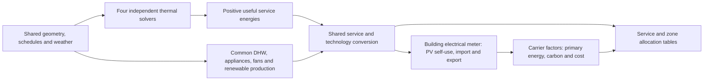

# Shared systems, carriers and renewables

The `dt_prototype.energy_carriers` package applies one set of conversion and accounting equations after the `Dynamic_RC`, `Monthly_SS`, `Monthly_SS_simplified` and `Monthly_SS_VBDD` thermal solvers. Its kernel accepts interval energies directly, so it can also be used with externally prepared monthly inputs. The supplied example compares five buildings using the same system configuration, DHW/electric/fan schedules and renewable production for every solver.

## Scope and comparable boundaries

The integrated workflow uses **useful sensible zone heating/cooling plus separate net sensible AHU heating/cooling**, followed by DHW and electrical ancillary loads. Dynamic conversion runs at the native thermal/weather time step; `Monthly_SS`, `Monthly_SS_simplified` and `Monthly_SS_VBDD` conversion runs monthly. Heating and cooling are kept positive and separate, including simultaneous heating and cooling in different zones.

The dynamic project settings must have `plants=false`, `latent=false`, and `pv_battery=false`. This selects the existing ideal thermal solver consistently with the earlier demand comparison. Legacy plants change radiative/convective emitter fractions and therefore thermal demand; merely subtracting their carrier outputs would not restore equivalence. Legacy plants and the new conversion are not applied together. The thermal-only commands retain their previous behaviour when `--energy-config` is omitted.

This comparison excludes latent conditioning, additional gross AHU reheat/cooling hidden by net sensible coil loads, storage, capacity limits and plant staging. DHW draw-off and the configured auxiliary loads are included. The public conversion API can consume other explicitly labelled thermal loads, but doing so does not make their boundary comparable to the monthly sensible solvers.

## Data flow



Individual zones are solved separately and their service demands are summed before applying the building systems and renewable allocation. Alternative collapsed-building cases are calculated separately. Renewables are sized once using the actual roof surfaces. There is one building meter, not one copy of the PV system per zone. Zone service tables allocate shared plant energy by useful-demand shares; collapsed cases cannot reconstruct upper/lower-zone demands.

## Service conversion equations

For service \(s\) and interval \(i\), define useful demand \(Q_{s,i}\) [kWh], and the downstream efficiency chain

\[
\eta_{s,chain}=\eta_{s,distribution}\eta_{s,emission}\eta_{s,regulation},\qquad
Q_{s,required}=Q_{s,i}/\eta_{s,chain}.
\]

All downstream efficiencies are strictly positive and at most one. Generator performance is a constant, linear or polynomial function of outdoor temperature in °C:

\[
p_s(T)=c_0+c_1T+c_2T^2+\cdots+c_nT^n,\qquad 0\leq n\leq5.
\]

`performance.coefficients` contains ascending powers. Performance means thermal generator output divided by carrier input: a boiler efficiency, heating COP or cooling EER. It may exceed one. Each curve declares a temperature validity interval and an explicit `clip` or `error` policy outside it. The complete polynomial domain is checked at endpoints and stationary points for strictly positive performance. Evaluated performance and clipping flags are retained for inspection.

Solar thermal is allocated to the DHW generator bus. With available collector heat \(Q_{ST,i}\), dynamic use is

\[
Q_{ST,use,i}=\min(Q_{DHW,required,i},Q_{ST,i}).
\]

For monthly calculations, a supplied matching/utilisation factor \(u_{ST,m}\in[0,1]\) multiplies this overlap. This factor approximates availability and matching within the month; it is not a storage simulation. Other services have zero solar-thermal allocation. Then

\[
Q_{s,generated,i}=Q_{s,required,i}-Q_{ST,use,s,i},\qquad
E_{s,carrier,i}=\frac{Q_{s,generated,i}}{p_s(T_i)}.
\]

The independently checked service identity is

\[
Q_{s,i}=\big(E_{s,carrier,i}p_s(T_i)+Q_{ST,use,s,i}\big)\eta_{s,chain}.
\]

Unallocated solar heat is reported as curtailed heat. Downstream losses are `generator_required_kWh - useful_demand_kWh`. Generator losses or ambient heat are not inferred from the service identity and are not mixed with purchased energy. Optional technology auxiliary electricity is \(a_sQ_{s,generated,i}\), with the dimensionless coefficient `auxiliary_kWh_per_kWh_generated` explicitly supplied.

The example maps exact template IDs/descriptions from `data/examples/systems_templates.json`. Space and DHW services use their corresponding supplied chains. AHU coils use generation and distribution efficiencies, with room emission/regulation factors set to one. This is an explicit adapter assumption. Unknown template names fail rather than silently selecting ideal consumption. New carrier identifiers and technology records can be added in configuration without editing a solver.

## Dynamic versus monthly efficiencies

For dynamic input power \(P_i\) [W], adapters first calculate \(Q_i=P_i\Delta t_i/1000\) [kWh]. They evaluate generator performance at each interval temperature. Monthly adapters supply monthly thermal energy and duration-weighted outdoor temperature:

\[
E_{s,m}^{dynamic}=\sum_{i\in m}\frac{Q_{s,generated,i}}{p_s(T_i)},\qquad
E_{s,m}^{monthly}=\frac{Q_{s,generated,m}}{p_s(\overline T_m)}.
\]

These coincide for constant efficiency when renewable allocation and other assumptions coincide. A linear COP does not make its inverse linear; consequently variable-performance dynamic and monthly conversion need not coincide. Do not average hourly COPs as a substitute for \(\sum Q/\sum E\). `service_monthly.csv` reports this output/input ratio as `effective_performance` where delivered energy is positive, and leaves it undefined for an idle generator.

`fit_performance_curve` in `src/dt_prototype/energy_carriers/curves.py` fits supplied temperature/performance samples by least squares. It returns serialisable coefficients, validity range, residuals, RMSE, maximum error and in-sample R². Samples must correspond to the same equipment service, supply-temperature regime and operating conditions. Fit diagnostics are not independent equipment validation. The baseline uses supplied constants; a separate sensitivity uses the existing Model 3 example linear curves, explicitly not fitted to these buildings. Polynomial behaviour has analytical tests.

## Common ancillary and renewable preprocessing

The common adapter uses each actual zone schedule for DHW, lighting/appliances and mechanical airflow, independent of thermal gains. AHU fan electricity uses the existing coefficient 0.4434 W/(m³/h) in the example. Configurable building base auxiliaries and technology auxiliaries are added explicitly; unspecified pumps or standby loads are not invented.

PV and collector production use the same existing roof irradiance mapping for every solver. With roof coverage \(f_A\), roof area \(A_r\), module density \(d_{PV}\) [kWp/m²], plane-of-array irradiance \(G_i\) [W/m²] and performance ratio PR:

\[
P_{PV,rated}=A_rf_Ad_{PV},\qquad
E_{PV,i}=P_{PV,rated}\frac{G_i}{1000}\Delta t_i\,PR.
\]

PV generation is AC energy before self-consumption allocation. The example's 45% coverage and module density come from the existing PV assumptions; PR=0.85 is a declared demonstration value. This simpler PR model is intentionally shared across all solvers and does not reproduce the legacy dynamic PV temperature model exactly.

Collector output at the generator bus is

\[
Q_{ST,i}=A_{ST}\max[\eta_0G_i-a_1\Delta T_i-a_2(\Delta T_i)^2,0]\Delta t_i/1000,
\qquad\Delta T_i=\max(T_{fluid}-T_{out,i},0).
\]

The collector area, optical efficiency, losses and fixed mean fluid temperature are configurable. Example collector coefficients and 5% roof coverage are illustrative; they are not the old auto-sized collector/tank calculation. PV and collector coverages may not sum to more than one. Weather-interval generation is summed for monthly users to keep production identical across models. The kernel itself only needs the resulting interval/monthly generation energies, and can accept externally computed or measured generation without hourly weather.

## PV factors and meter balance

Gross electrical load includes all electrically supplied services, service auxiliaries, appliances/lighting, AHU fans and configured base auxiliaries:

\[
L_i=\sum_{s\to electricity}E_{s,i}+E_{aux,i}+E_{appliances,i}+E_{fans,i}+E_{base,i}.
\]

Dynamic matching without storage is \(S_i=\min(L_i,E_{PV,i})\). Monthly configuration explicitly chooses one of two factor conventions:

| `pv.factor_basis` | Meaning | Monthly self-consumption |
| --- | --- | --- |
| `overlap` | Fraction of maximum monthly overlap | \(S_m=f_m\min(L_m,E_{PV,m})\) |
| `generation` | Requested fraction of PV generation self-consumed | \(S_m=\min(f_mE_{PV,m},L_m,E_{PV,m})\) |

The factor is either one scalar for every month or twelve January–December values, each in [0,1]. If a generation fraction implies more self-use than electrical load, the value is capped and `pv_factor_capped` records it. No factor is inferred or silently chosen by the kernel. The example uses twelve overlap factors of 0.65 solely to exercise the accounting. Factors may differ by building; a future ISO calculation may supply them or an explicit matching provider can be added.

Import and export follow separate meter identities:

\[
I_m=L_m-S_m,\quad X_m=E_{PV,m}-S_m,\quad
I_m+E_{PV,m}=L_m+X_m.
\]

Both import and export can be positive in a month. Export never offsets gas or another carrier's physical consumption. Storage is not implicitly attached. Derived output diagnostics include self-use/PV generation, self-use/load and self-use/min(load,PV); zero denominators remain undefined. Dynamic derived factors can later be compared with ISO factors without fitting the monthly model to them.

## Carrier factors, carbon and monetary accounting

Each carrier has explicit scalar or twelve-month import and export factors, provenance, and a common declared currency. Missing factors are rejected. At month \(m\), imported nonrenewable and renewable primary energy are

\[
PE_{nren,m}=\sum_c I_{c,m}f_{c,nren,m},\qquad
PE_{ren,m}=\sum_c I_{c,m}f_{c,ren,m}.
\]

Imported operational carbon is \(\sum_c I_{c,m}f_{c,CO2,m}\) [kgCO2e]; energy cost is \(\sum_c I_{c,m}p_{c,m}\) [currency units]. Export primary-energy/carbon credits and export revenue use their own explicit factors and are reported separately. Net values subtract these credits from import totals. Negative tariffs are allowed; primary and carbon factors are nonnegative under this schema.

These are **import-boundary primary-energy indicators**. On-site PV, solar heat and heat-pump ambient energy are not automatically added as renewable primary-energy terms. A complete regulatory primary-energy boundary, country-specific factors or export-credit convention must be supplied/extended explicitly. The example sets export primary/carbon credits to zero while demonstrating a separate export price. Prices are variable energy charges only, without taxes, standing charges or demand charges. All example factor/price values are illustrative, not current national factors or tariffs.

## Commands

From the prototype directory after installing the package, or with `src` on `PYTHONPATH`:

```powershell
# Complete five-building comparison, including all thermal variants.
python -m dt_prototype.energy_carriers.cli --config configs/example.json --energy-config configs/energy_example.json --engine all --output outputs/my_energy_comparison

# Individual solver; dynamic supports 5R1C or 7R2C.
python -m dt_prototype.energy_carriers.cli --config configs/example.json --energy-config configs/energy_example.json --engine Dynamic_RC --model 7R2C --output outputs/my_dynamic_energy

# Existing entry points accept the additional optional layer.
python -m dt_prototype.cli monthly --config configs/example.json --energy-config configs/energy_example.json --output outputs/my_monthly_energy
python -m dt_prototype.cli simplified --config configs/example.json --energy-config configs/energy_example.json --zone-mode both --output outputs/my_simplified_energy
python -m dt_prototype.monthly_ss_vbdd.cli --config configs/example.json --energy-config configs/energy_example.json --solar temperature_linear --output outputs/my_vbdd_energy

# Generate a separate explicit example config from supported supplied templates.
python -m dt_prototype.energy_carriers.cli --config configs/example.json --write-example-energy-config configs/my_energy_example.json
```

Outputs and generated configurations refuse to overwrite existing paths. Example configuration generation is an explicit action and never substitutes defaults silently during an energy calculation. The `dt-energy-carriers` installed command is equivalent to `python -m dt_prototype.energy_carriers.cli`.

## Direct monthly API and future extension

```python
from dt_prototype.energy_carriers import EnergyConfig, calculate

cfg = EnergyConfig.load("configs/energy_example.json")
# inputs: a DataFrame with complete monthly rows, or contiguous dynamic intervals.
result = calculate(inputs, cfg, building_id="18", resolution="monthly")
monthly = result.monthly()
```

Required columns: `time` (local-standard-time interval start), `period_id` (`YYYY-MM`), `duration_h`, `outdoor_temp_C`, and positive kWh fields `zone_heating`, `ahu_heating`, `zone_cooling`, `ahu_cooling`, `dhw`, `appliances`, `fans`, `base_auxiliary`, `pv_generation`, `solar_thermal_available` each suffixed `_kWh`. Unused quantities must be explicitly zero. Monthly rows cover complete calendar months, including leap-month durations; dynamic rows are contiguous and may not cross a month boundary. Inputs must be finite and cannot contain negative demand energies.

Add a technology record, assign it to a building's service, and provide factors for its carrier. Thermal solvers remain unchanged. Distinct heating/DHW/coil technologies can use distinct curves and losses. More complex technologies with multiple simultaneous carrier outputs, bivalent dispatch, supply-temperature dependence, capacity/part-load dependence or storage will require a new explicit conversion/dispatch implementation; a polynomial in outdoor temperature must not be used to imply those unmodelled effects. The current schema rejects unknown fields so unsupported assumptions cannot be silently ignored.

## Verification and outputs

Analytical tests cover independently calculated conversion/meter/impact examples; PV-free and load-free cases; solar heat at the DHW generator bus; fractional matching; generation-factor clipping; auxiliary electricity; constant-efficiency aggregation; variable-COP differences; polynomial fits/domain positivity; invalid inputs; subhourly integration; leap months; and signed tariffs. Integration tests use actual shared schedules and all five buildings, check QSS/VB equivalence, zone allocation, independent simplified execution and command routing.

The generated report includes monthly/annual carrier, primary-energy, carbon and cost tables, figures for each building, differences against QSS, reconciliation against the supplied heating/cooling report, PV-factor sensitivity, dynamic-derived monthly matching diagnostics and a separate linear-curve sensitivity. Detailed service tables retain performance and clipping flags. A manifest records resolved settings, assumptions, hashes, runtime versions and all balance residuals. Balances use \(10^{-6}+10^{-9}|E|\) kWh tolerance.

The final [five-building report](../reports/shared_energy/comparison_report.md) includes linked individual-zone appendices and annual as well as monthly service/ancillary tables. To regenerate and attach automated test evidence after a calculation:

```powershell
New-Item -ItemType Directory -Path outputs -Force | Out-Null
python -m pytest -q -p no:cacheprovider --basetemp outputs/tests_current --junitxml=outputs/test_results.xml
python scripts/audit_shared_energy_delivery.py --output outputs/my_energy_comparison --config configs/example.json --pytest-xml outputs/test_results.xml
```

The audit checks current input/configuration/source hashes against the run, validates local report links, and attaches the completed test-suite evidence. A source or input change requires a fresh calculation before this audit can succeed.

Software verification, historical thermal regression and cross-model comparison establish implementation consistency. They do not establish measured-consumption accuracy or conformance with the ISO spreadsheet that is to be supplied later.

## Monthly Excel companions

The [current workbook instructions](workbook_instructions.md) link three formula-driven editions: `Monthly_SS`, `Monthly_SS_simplified` and `Monthly_SS_VBDD`. They expose the same service conversion, carrier allocation, monthly PV/solar matching, meter balances and impact equations. The `Monthly_SS_VBDD` workbook follows the selected monthly/linear/fixed thermal variant. Original individual-zone thermal sheets remain available; system and renewable balances use the building meter. Prepared weather/ancillary/renewable production is explicitly imported. Frozen Python results supply terminal checks only.

See [native workbook validation](../reports/workbooks/workbook_validation.md) for full numerical coverage, input perturbations, error scanning and save/reopen evidence. The [architecture](architecture.md) and [data contracts](data_contracts.md) define the shared responsibilities and time/unit boundaries. This workbook extension does not change thermal solvers or the energy engine.
