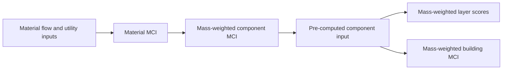

# Standalone Circularity module

This folder implements the Material Circularity Indicator (MCI) at material, component and building level. It remains independent from the DT-Prototype pipeline. The equations and worked example follow the supplied `how_is_material_circularity_indicator_mci.md` reference.

## Run

Calculate material rows and component scores:

```text
python run_circularity.py --mode component --input component_case.json --output component_results
```

Aggregate pre-computed component MCI values into layer and building scores:

```text
python run_circularity.py --mode building --input building_case.json --output building_results
```

Each run creates `results.json`, a flat CSV detail table and a manifest containing input and code hashes. The output directory must not already exist.

For later DT-Prototype integration, treat `component_id` as the physical
`asset_id`, retain its stable `category_id`, and publish the pre-computed MCI
with component mass. The downstream `Assessment` runner mass-weights those
external asset results without repeating the material calculation. The shared
contract and canonical technical-system names are described in
`../../docs/assessment_integration.md`.

Run the independent checks from this folder with `python -m unittest discover -s tests -v`.

## Workbooks

`mci_components.xlsx` calculates virgin input, unrecovered material, recycling losses, attributed waste, LFI, utility and MCI for each material row. It then mass-weights the material scores into a component MCI. The first row reproduces the supplied 1,000 kg worked example and returns 0.775.

`mci_building.xlsx` accepts pre-computed component MCI and component mass. It calculates layer scores and the building score using `SUM(mass × MCI) / SUM(mass)`. These workbooks contain illustrative inputs; replace the amber cells with project data and document each recovery scenario.

## Architecture



MCI measures material-flow circularity and utility. It does not replace LCA. Biological materials require additional methodology provisions and are not automatically credited as circular by this implementation.
