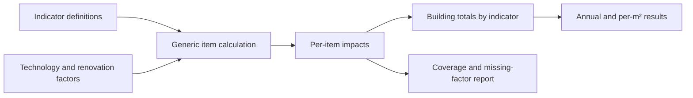

# Extensible LCA indicator model

## Data model

`indicator_definitions` is an ordered list. Every definition requires a stable `id`, display `name`, result `unit`, and factor unit. Technology and renovation records supply `indicator_factors` keyed by the same ID. The calculation returns:

- `technology_details[].impacts[indicator_id]`: factor, annual impact and project total for one item;
- `renovation_impacts[indicator_id]`: area-based renovation contribution;
- `indicator_results[indicator_id]`: annual building total, project total, annual intensity per m², coverage status and missing-factor list.

Negative factors are accepted because some life-cycle modules can contain credits or biogenic removals. Quantities and service lives remain non-negative/positive. A building total is calculated only when all non-zero technology rows and the renovation record have a factor for that indicator.

An omitted generic factor or JSON `null` means missing. A zero-quantity item
contributes zero with an unknown factor retained in the result metadata; a
non-zero item with a missing factor blocks the corresponding building total.

## Level(s) registry

The supplied `indicator_catalog.json` includes the existing primary-energy metric and the full environmental impact-category table in Level(s) Indicator 1.2, Table 6:

- GWP-total, GWP-fossil, GWP-biogenic and GWP-luluc;
- ODP and AP;
- EP-freshwater, EP-marine and EP-terrestrial;
- POCP;
- ADP-minerals and metals, and ADP-fossil;
- WDP.

The source is European Commission/JRC, *Level(s) indicator 1.2: Life cycle Global Warming Potential user manual*, version 1.1, Table 6: https://susproc.jrc.ec.europa.eu/product-bureau/sites/default/files/2021-01/UM3_Indicator_1.2_v1.1_37pp.pdf

## Adding an indicator

1. Add one definition to the catalog with a unique ID and correct unit.
2. Add a factor under that ID to every non-zero technology and to `renovation.indicator_factors`.
3. Run the model and require `indicator_results[id].status == "complete"`.
4. Keep the factor's EPD/database source, life-cycle modules, geography, year and data-quality metadata alongside the input when the module is integrated.

The aggregation formula is common to every indicator; no Python branch is needed. The existing pre-retrofit energy/carbon comparison remains a separate legacy calculation until carrier-specific characterization factors for the other indicators are defined.

